

# HUB Pro
### by Mestres da Informática

**A central gratuita para cuidar do seu PC: em português, sem anúncios e sem coleta de dados.**

&nbsp;

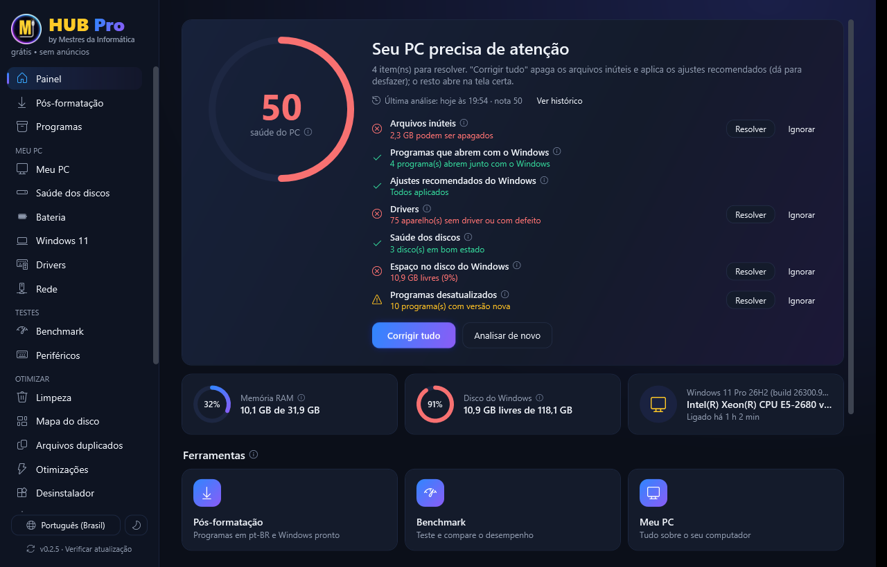

---

## Índice

- [Como baixar e instalar](#como-baixar-e-instalar)
- [Novidades da versão 0.2.5](#novidades-da-versão-025)
- [Guia de cada tela](#guia-de-cada-tela)
  - [Painel](#painel) · [Pós-formatação](#pós-formatação) · [Programas](#programas)
  - **Meu PC:** [Meu PC](#meu-pc) · [Saúde dos discos](#saúde-dos-discos) · [Pendrive falsificado](#pendrive-cartão-ou-hd-externo-falsificado) · [Bateria](#bateria) · [Windows 11](#windows-11) · [Drivers](#drivers) · [Rede](#rede)
  - **Testes:** [Benchmark](#benchmark) · [Periféricos](#periféricos)
  - **Otimizar:** [Limpeza](#limpeza) · [Mapa do disco](#mapa-do-disco) · [Arquivos duplicados](#arquivos-duplicados) · [Otimizações](#otimizações) · [Desinstalador](#desinstalador) · [Inicialização](#inicialização)
  - **Segurança:** [Reparar o Windows](#reparar-o-windows) · [Pontos de restauração](#pontos-de-restauração) · [Central Desfazer](#central-desfazer) · [Backup para formatar](#backup-para-formatar)
  - [Sobre e avisos de vídeo novo](#sobre-e-avisos-de-vídeo-novo)
- [Segurança em primeiro lugar](#segurança-em-primeiro-lugar)
- [Privacidade](#privacidade)
- [Perguntas comuns](#perguntas-comuns)

---

## Como baixar e instalar

1. Clique em **[Baixar o HUB Pro](https://github.com/mestresdainformatica/HUB-Pro/releases/latest)**.
2. Em **Assets**, baixe o **`HUB-Pro-Setup-...exe`** (instalador). Se preferir usar sem instalar, baixe o `MestresHub.exe` (versão portátil).
3. Abra e siga o instalador. O HUB Pro pede permissão de administrador porque mexe nas configurações do Windows.

> **O Windows mostrou "O Windows protegeu o computador"?** Isso aparece em programas novos que ainda não têm assinatura digital paga. Clique em **Mais informações → Executar assim mesmo**. Baixe sempre **só por esta página** ou pelos links do canal.

**Atualizações:** o HUB Pro avisa sozinho quando sai uma versão nova e se atualiza em um clique. Depois de atualizar, a janela **"O que há de novo"** mostra tudo o que mudou.

**Requisitos:** Windows 10 (1809 ou mais novo) ou Windows 11, 64 bits.

**Idiomas:** português do Brasil, português de Portugal, español e English. Na primeira vez, o HUB abre no idioma e no tema (claro ou escuro) do Windows. O tema troca na hora, com um clique no canto de baixo do menu.

---

## Novidades da versão 0.2.5

**Funções novas**
- **Backup para formatar:** salve os drivers e as redes Wi-Fi num pendrive. Depois de formatar, a Pós-formatação acha o backup e devolve tudo sozinha.
- **Reparar o Windows:** DISM, SFC, verificação do disco, banco de dados WMI, cache de ícones e configuração de internet, com um resumo simples no fim.
- **Pontos de restauração:** veja, crie, apague e volte o Windows para uma data em que tudo funcionava.
- **Mapa do disco:** veja num mapa de blocos o que está enchendo o disco.
- **Arquivos duplicados:** ache cópias iguais e escolha o que mandar para a Lixeira.
- **Bateria:** saúde da bateria do notebook, ciclos de carga e o histórico da capacidade.
- **Windows 11:** confira se o PC atende aos requisitos e o que fazer em cada item.
- **Periféricos:** teste o teclado, o mouse, a tela (pixels mortos), os alto-falantes, o microfone e a webcam.
- **Pendrive falsificado:** descubra se um pendrive, cartão ou HD externo é falsificado e quanto ele guarda de verdade, com a identificação do aparelho (fabricante, chip USB, número de série e velocidade).
- **Inicialização:** quanto tempo o Windows leva para ligar e o que atrasou.
- **Meu PC:** relatório para pedir ajuda, sem dados pessoais, e o botão **Copiar resumo** para colar num comentário ou no WhatsApp.
- **Benchmark:** teste de inteligência artificial e o teste **Uso do dia a dia (pesado)**, com documentos, o site e os vídeos do canal, planilha, fotos e várias coisas ao mesmo tempo.
- **Programas:** busque qualquer programa do winget e da Microsoft Store, com as versões em português primeiro.
- **Painel:** histórico das análises e o aviso de vídeo novo do canal.

**Melhorias:** a nota do Benchmark agora usa como referência um PC médio de hoje e junta todas as categorias. Também entraram animações na Limpeza e nas Otimizações, e a reinstalação dos apps removidos pela aba Bloatware.

**Correções:** a barra de progresso não sai mais para fora da linha.

---

## Guia de cada tela

### Painel

A tela inicial. Um clique em **Analisar** confere o PC em menos de um minuto e dá uma **nota de saúde de 0 a 100**. A conferência cobre arquivos inúteis, programas que abrem com o Windows, ajustes recomendados, drivers, saúde dos discos, espaço livre e programas desatualizados.

**Como usar:** clique em **Analisar**. Em cada item, use **Resolver** para ir direto à tela certa, ou **Corrigir tudo** para aplicar só o que é seguro (limpeza e ajustes que podem ser desfeitos). **Ver histórico** mostra a nota de cada análise, para saber se o PC está melhorando.

---

### Pós-formatação

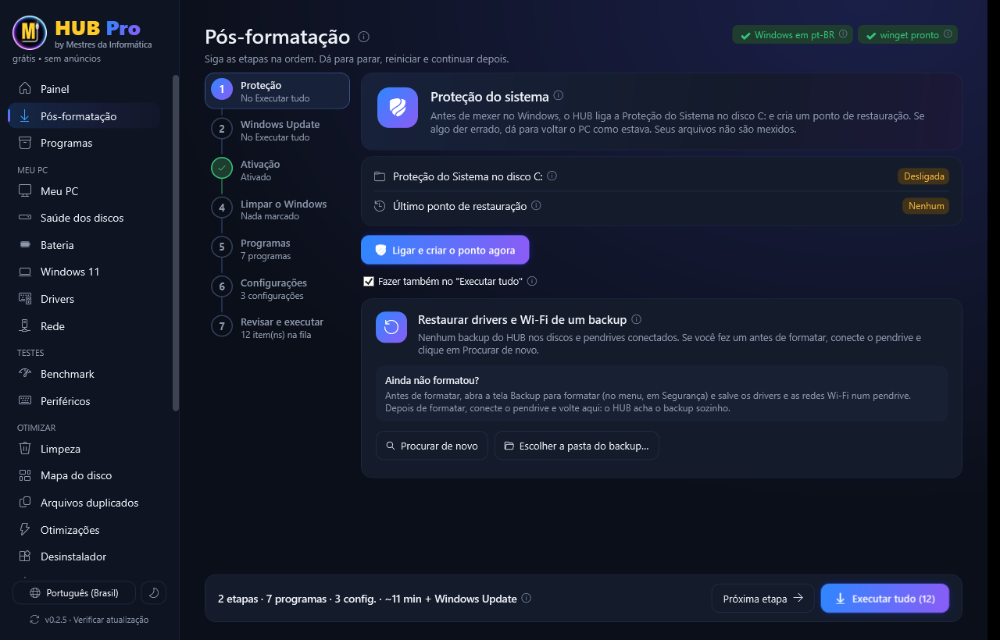

Tudo para depois de formatar, em 7 etapas e na ordem certa:
1. proteção do sistema;
2. Windows Update;
3. ativação;
4. limpar o Windows;
5. programas;
6. configurações;
7. revisão.

Os programas são instalados pelo instalador oficial da Microsoft (winget), direto do site de cada fabricante e **já em português**.

**Como usar:** siga as etapas pela lista da esquerda, marque o que quer e clique em **Executar tudo**. Dá para parar, reiniciar o PC e continuar depois. Se você fez o [Backup para formatar](#backup-para-formatar), a primeira etapa acha o backup e devolve os drivers e as redes Wi-Fi.

---

### Programas

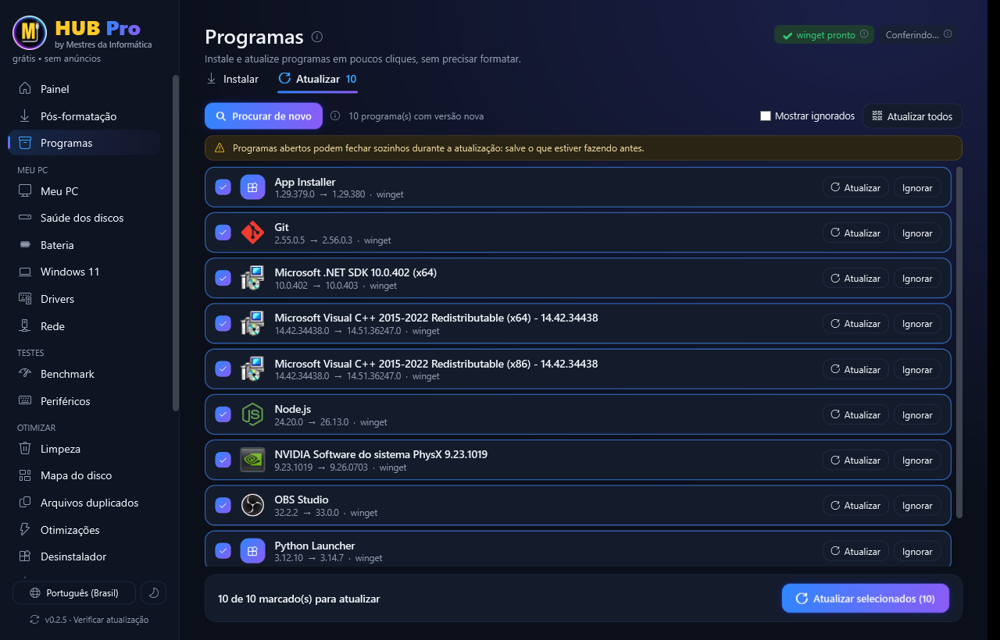

Instale programas com um clique e veja quais dos seus programas têm versão nova. A busca procura em todo o catálogo do winget e da Microsoft Store, com as versões em português primeiro e o idioma de cada uma indicado.

**Como usar:** na aba **Instalar**, marque os programas e clique em instalar. Na aba **Atualizar**, marque o que quer atualizar e clique em **Atualizar selecionados**. Feche os programas antes, para não perder o que estiver aberto.

---

### Meu PC

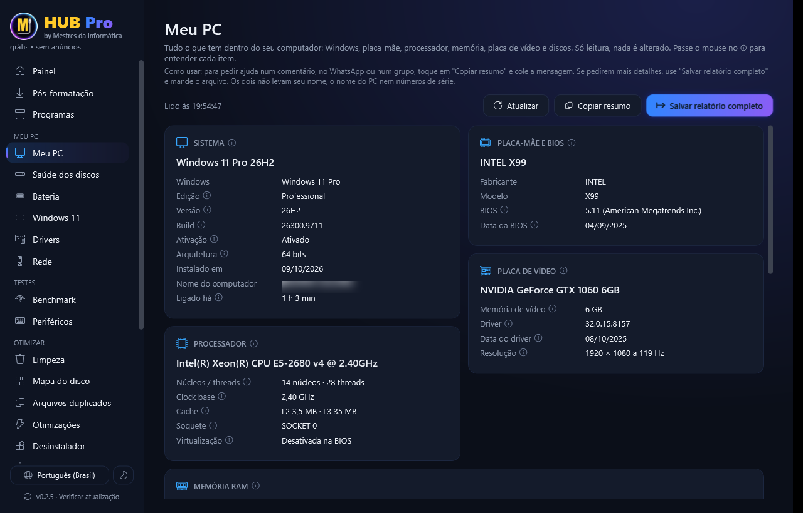

Tudo o que tem dentro do computador: Windows, placa-mãe, processador, memória, placa de vídeo e discos. Só leitura: nada é alterado. Passe o mouse no ⓘ de cada item para entender o que ele significa.

**Para pedir ajuda:** clique em **Copiar resumo** e cole no comentário do YouTube, no WhatsApp ou no grupo. Se pedirem mais detalhes, use **Salvar relatório completo**, que inclui telas azuis recentes, aparelhos sem driver, tempo para ligar, saúde dos discos, bateria e requisitos do Windows 11. **O relatório não leva o seu nome, o nome do PC nem números de série.**

---

### Saúde dos discos

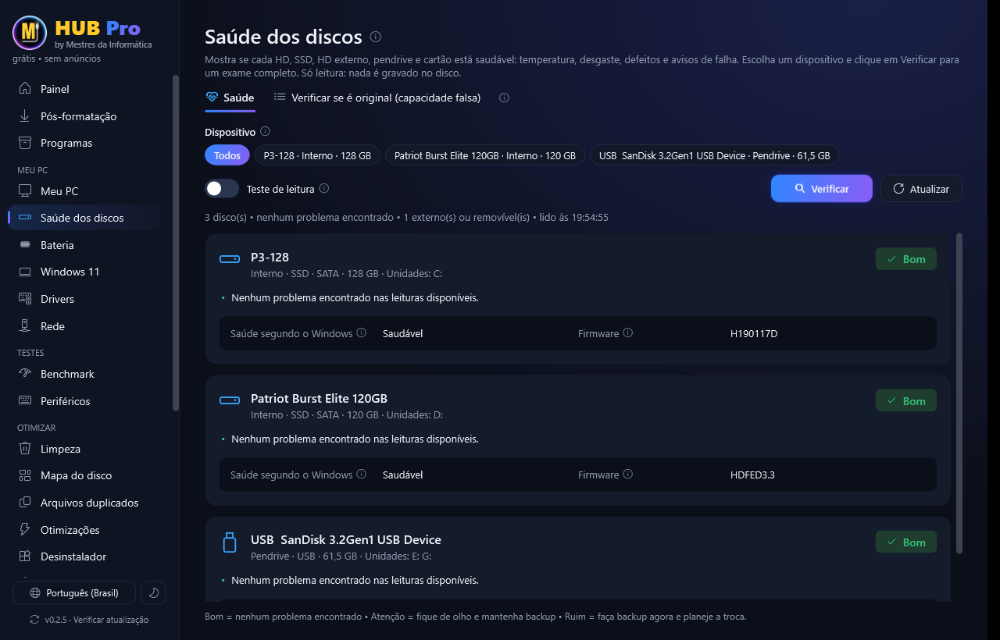

Mostra se cada HD, SSD, HD externo, pendrive e cartão está saudável: temperatura, desgaste e avisos de falha (S.M.A.R.T.).

**Como usar:** escolha o dispositivo e clique em **Verificar** para um exame completo, só de leitura. Ligue o **Teste de leitura** para ler o disco inteiro e achar setores com defeito.

---

### Pendrive, cartão ou HD externo falsificado

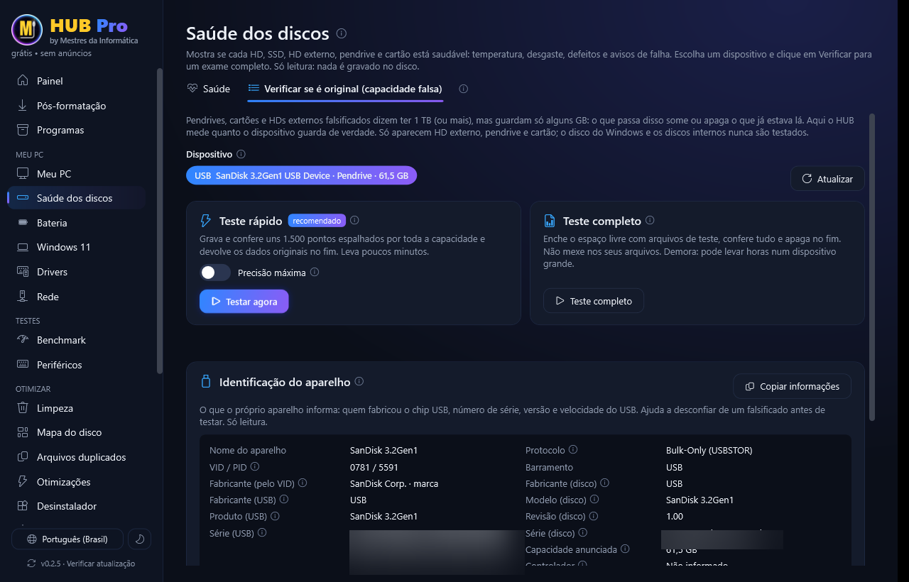

Na aba **Verificar se é original**, da tela Saúde dos discos. Muitos pendrives e cartões vendidos como "1 TB" ou "2 TB" guardam só alguns GB. O que passa disso some ou apaga o que já estava lá.

- **Teste rápido:** grava e confere cerca de 1.500 pontos espalhados por toda a capacidade e devolve os dados originais no fim. Em poucos minutos mostra **quanto o aparelho guarda de verdade**.
- **Teste completo:** enche o espaço livre com arquivos de teste, confere tudo e apaga no fim. Não mexe nos seus arquivos.
- **Identificação do aparelho:** mostra o que o próprio aparelho informa. Isso inclui o fabricante pelo código USB (VID/PID), o número de série, a versão e a velocidade do USB e o consumo. Aparecem **sinais de alerta**, como marca que não bate com o chip USB, número de série genérico, ou aparelho "USB 3" funcionando como USB 2.

O disco do Windows e os discos internos nunca são testados. A identificação dá pistas, mas a prova de verdade é o teste de gravação.

---

### Bateria

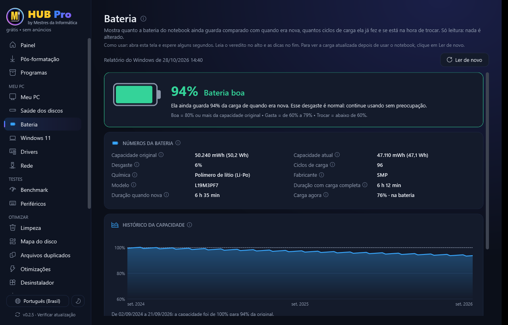

Para notebooks. Mostra quanto a bateria ainda guarda comparado com quando era nova, quantos ciclos de carga ela já fez e se está na hora de trocar, com o gráfico do histórico da capacidade. Os números vêm do relatório de bateria do próprio Windows.

---

### Windows 11

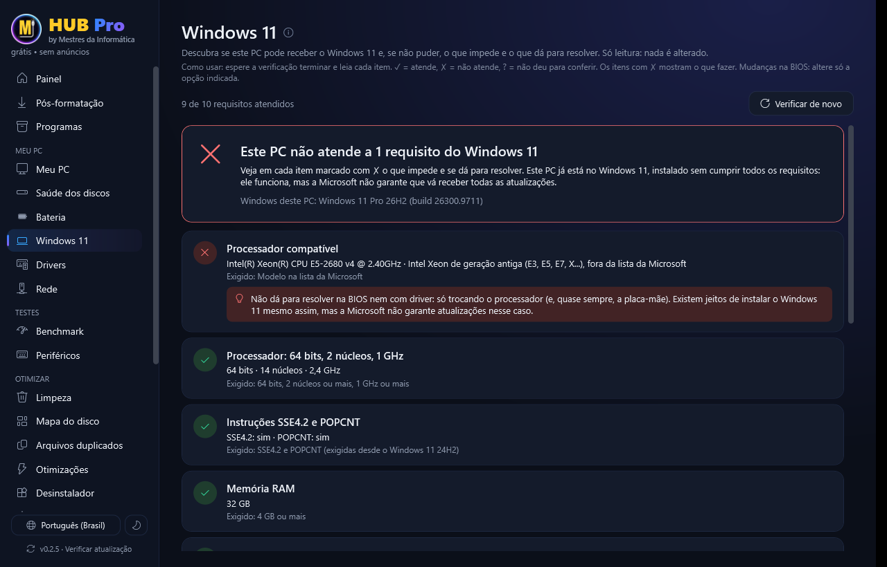

Confere, item por item, se o PC atende aos requisitos do Windows 11. A lista cobre:
- processador compatível e as instruções SSE4.2/POPCNT;
- memória e armazenamento;
- UEFI, Inicialização Segura e TPM 2.0;
- DirectX 12 e tela.

Cada item marcado com ✗ diz o que fazer, por exemplo ligar o TPM ou a Inicialização Segura na BIOS. Só leitura: nada é alterado.

---

### Drivers

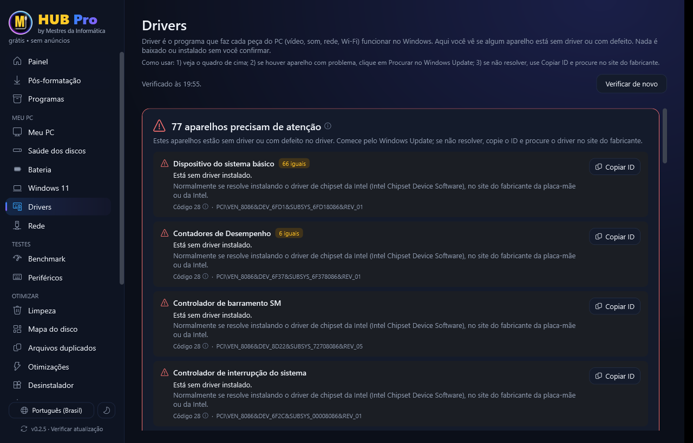

Mostra os aparelhos sem driver ou com defeito, com o ID para procurar o driver certo. Também tem:
- **Drivers pelo Windows Update**, dentro do HUB;
- o driver da placa de vídeo **NVIDIA, AMD ou Intel** pelo instalador oficial de cada fabricante, com a assinatura digital conferida;
- **backup e restauração dos drivers**.

Antes de instalar qualquer driver, o HUB cria um ponto de restauração.

---

### Rede

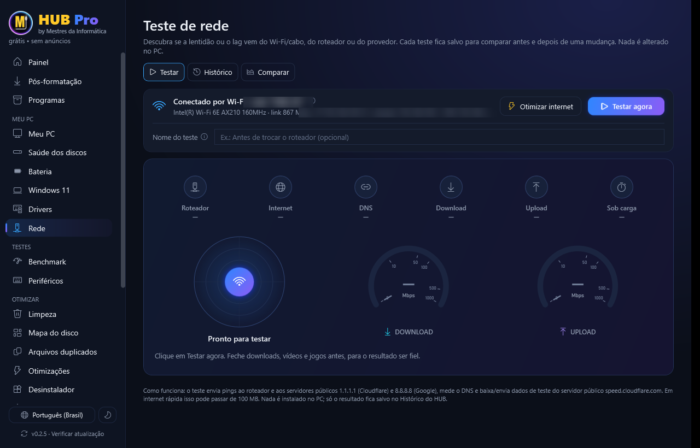

Teste de internet que mostra **onde está o problema**: no Wi-Fi/cabo, no roteador ou no provedor. Mede lag, perda de pacotes, DNS, download, upload e o comportamento com a internet carregada. Cada teste fica salvo para comparar antes e depois de uma mudança. O botão **Otimizar internet** aplica ajustes que podem ser desfeitos.

---

### Benchmark

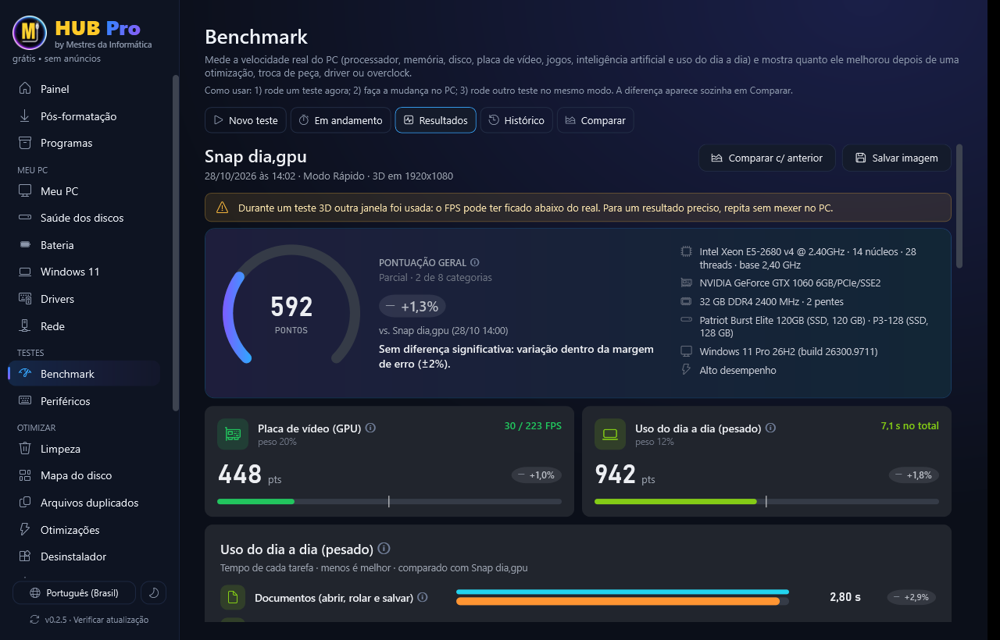

Mede a velocidade real do PC em 8 categorias:
- processador (1 núcleo e todos os núcleos);
- memória e disco;
- placa de vídeo e simulação de jogo;
- inteligência artificial;
- uso do dia a dia (pesado).

**1.000 pontos = um PC médio de hoje.** O dobro da pontuação é o dobro do desempenho.

**Como usar:**
1. Rode um teste.
2. Faça a mudança no PC (otimização, troca de peça, driver, overclock).
3. Rode outro teste no mesmo modo.

A diferença aparece sozinha em **Comparar**.

---

### Periféricos

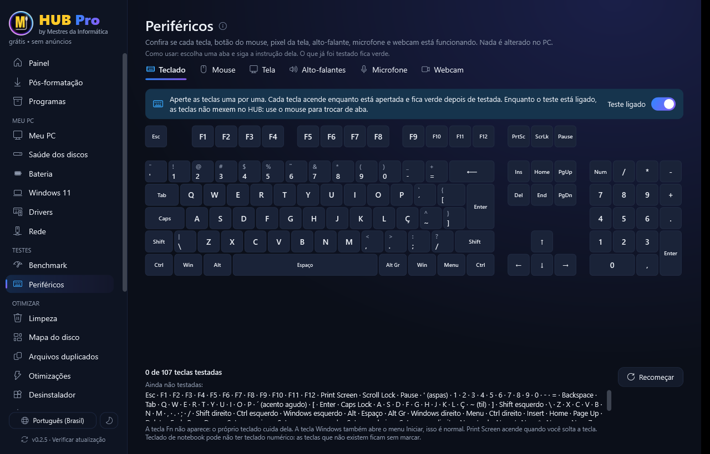

Testa se tudo está funcionando:
- **Teclado:** desenho ABNT2 que acende cada tecla.
- **Mouse:** todos os botões e a rolagem.
- **Tela:** cores em tela cheia para achar pixels mortos.
- **Alto-falantes:** som no lado esquerdo e no lado direito.
- **Microfone:** nível do som ao vivo e gravação de teste.
- **Webcam.**

Nada é alterado no PC.

---

### Limpeza

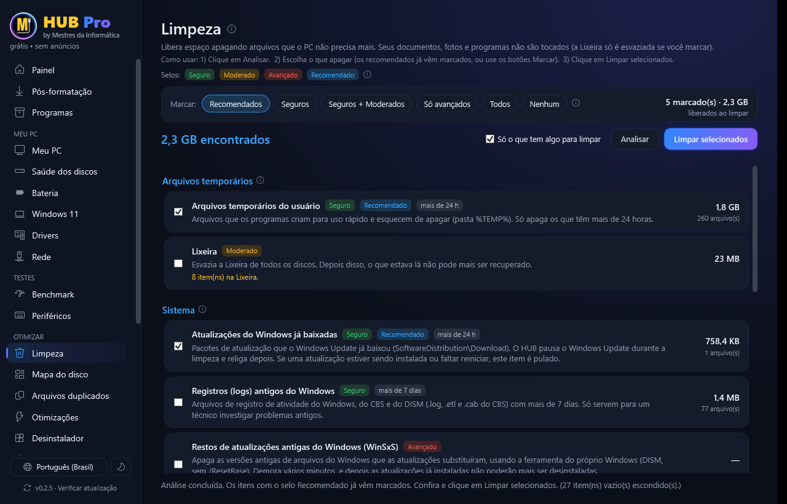

Libera espaço apagando o que o PC não precisa mais: arquivos temporários, caches e restos de atualizações. Seus documentos, fotos e senhas **nunca** são tocados, e a limpeza nunca entra em atalhos de pasta.

**Como usar:** clique em **Analisar**, confira os itens (os com o selo **Recomendado** já vêm marcados) e clique em **Limpar selecionados**.

---

### Mapa do disco

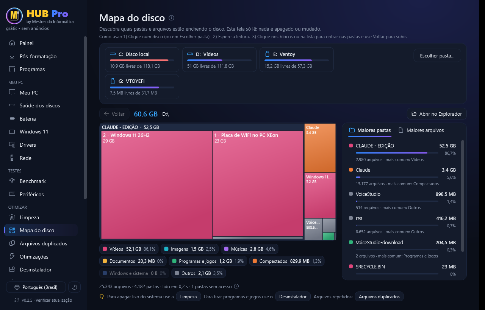

Mostra num mapa de blocos quais pastas e arquivos estão enchendo o disco: quanto maior o bloco, mais espaço ele ocupa. Tem também a lista das maiores pastas e dos maiores arquivos, e o resumo por tipo (vídeos, imagens, programas e jogos...). **Só olha: nada é apagado.**

**Como usar:** clique num disco (ou em **Escolher pasta**), espere a leitura e clique nos blocos para entrar nas pastas.

---

### Arquivos duplicados

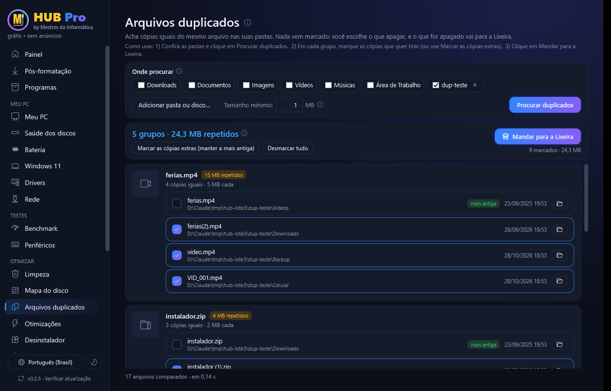

Acha cópias iguais do mesmo arquivo nas suas pastas, mesmo com nomes diferentes. A comparação é feita pelo conteúdo do arquivo. **Nada vem marcado:** você escolhe o que apagar, e o que for apagado vai para a **Lixeira**. O HUB nunca deixa apagar todas as cópias de um arquivo, e pastas do Windows e de programas ficam de fora.

**Como usar:** marque as pastas, clique em **Procurar duplicados**, marque as cópias que quer tirar (ou use **Marcar as cópias extras**) e clique em **Mandar para a Lixeira**.

---

### Otimizações

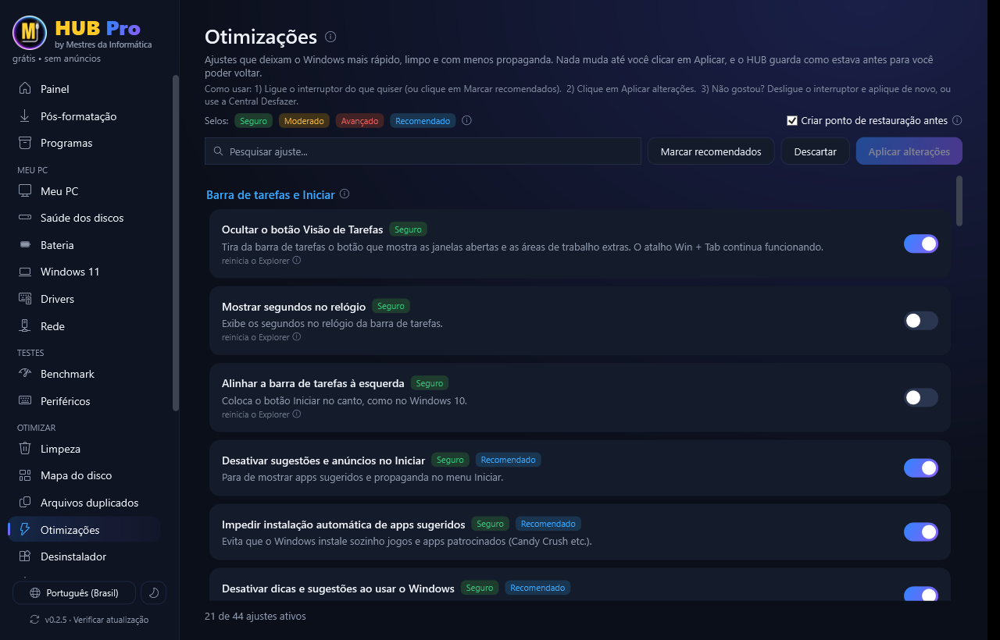

Ajustes que deixam o Windows mais rápido, limpo e com menos propaganda e rastreamento. Cada ajuste tem um selo (Seguro, Moderado, Avançado) e uma explicação. Nada muda até você clicar em **Aplicar**, e o HUB guarda como estava antes: tudo pode ser desfeito na [Central Desfazer](#central-desfazer).

---

### Desinstalador

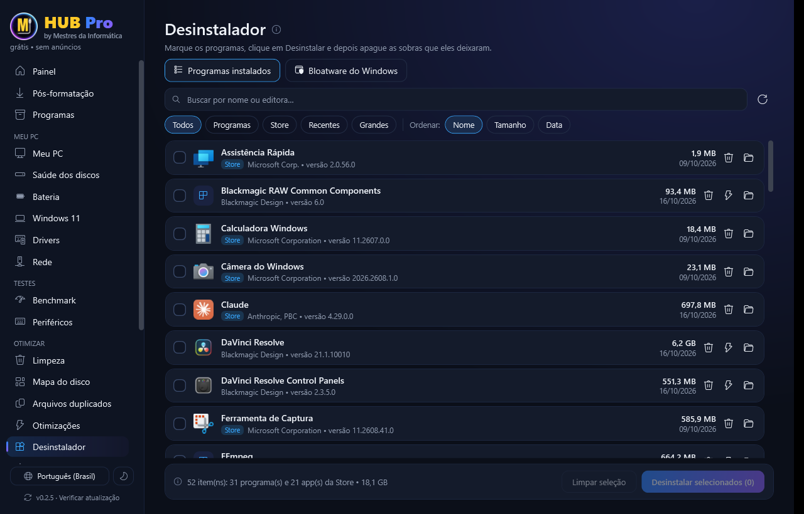

Desinstala vários programas de uma vez e apaga as sobras que ficam para trás. Na aba **Bloatware do Windows** dá para remover os apps de propaganda que já vêm no Windows e **reinstalar** qualquer um deles depois, se quiser.

---

### Inicialização

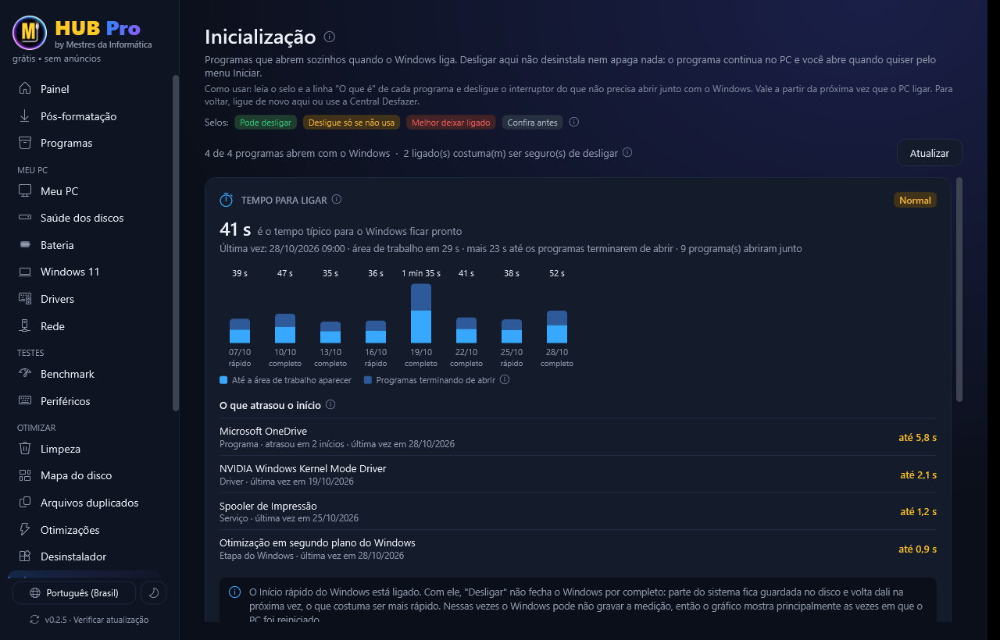

Mostra **quanto tempo o Windows leva para ligar**, com o gráfico das últimas vezes e o que atrasou o início. Também lista os programas que abrem junto com o Windows, cada um com ícone, explicação e um selo dizendo se é seguro desligar. Desligar aqui não desinstala nada.

---

### Reparar o Windows

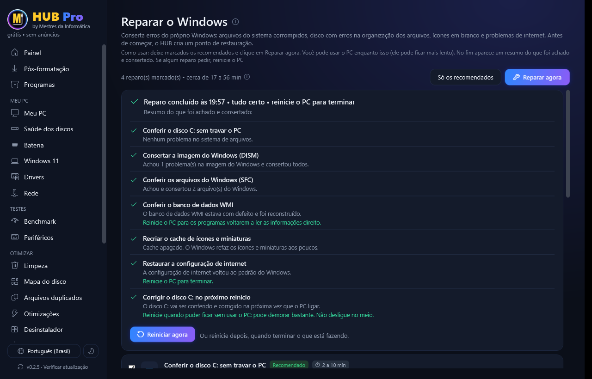

Conserta erros do próprio Windows com as ferramentas oficiais da Microsoft, na ordem que ela recomenda:
- **Disco:** verificação do disco (chkdsk) e correção no próximo reinício.
- **Arquivos do Windows:** DISM e SFC.
- **Programas e telas que mostram erro:** banco de dados WMI.
- **Ícones em branco:** cache de ícones.
- **Internet:** configuração de internet.

Antes de começar, o HUB cria um ponto de restauração. No fim aparece um resumo simples do que foi achado e consertado.

**Como usar:** deixe marcados os recomendados e clique em **Reparar agora**. Você pode usar o PC enquanto isso.

---

### Pontos de restauração

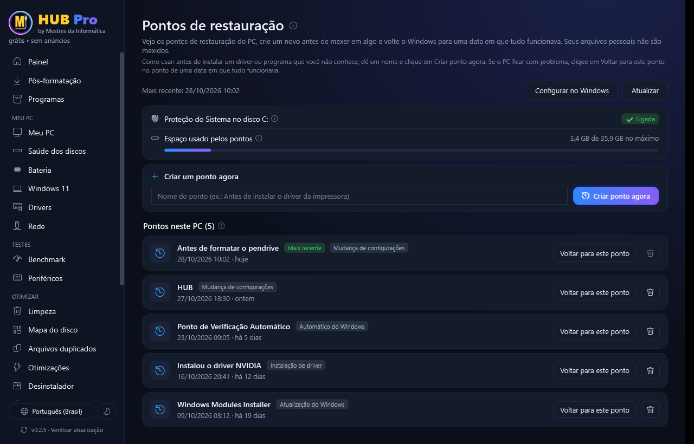

Veja os pontos de restauração do PC, quanto espaço eles usam e se a proteção está ligada. Antes de instalar algo que você não conhece, crie um ponto com o nome que quiser. Se o PC ficar com problema, clique em **Voltar para este ponto**. O mais recente nunca pode ser apagado pelo HUB, para você sempre ter uma volta segura.

---

### Central Desfazer

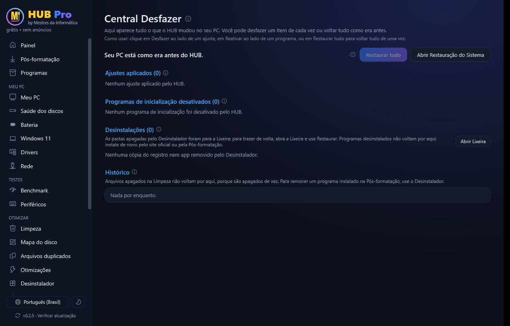

Lista tudo o que o HUB mudou no PC (ajustes, programas da inicialização, desinstalações) e volta cada coisa como era, uma de cada vez ou tudo de uma vez. Também abre a Restauração do Sistema do Windows.

---

### Backup para formatar

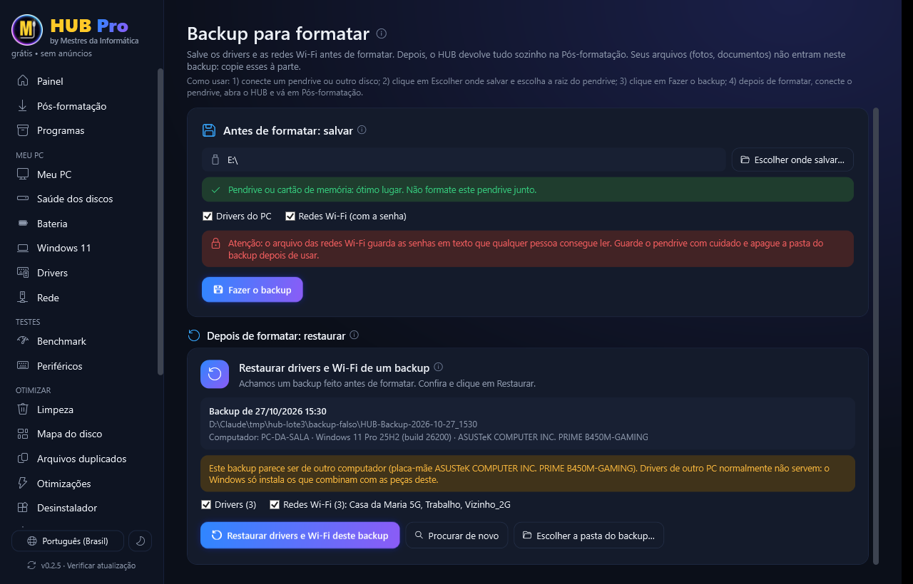

Antes de formatar, salve **os drivers e as redes Wi-Fi (com as senhas)** num pendrive. Depois de formatar, conecte o pendrive, abra o HUB e vá em **Pós-formatação**: o HUB acha o backup e devolve tudo sozinho.

**Atenção:** o arquivo das redes Wi-Fi guarda as senhas em texto legível. Guarde o pendrive com cuidado e apague a pasta do backup depois de usar. Seus arquivos pessoais (fotos, documentos) não entram neste backup: copie esses à parte.

---

### Sobre e avisos de vídeo novo

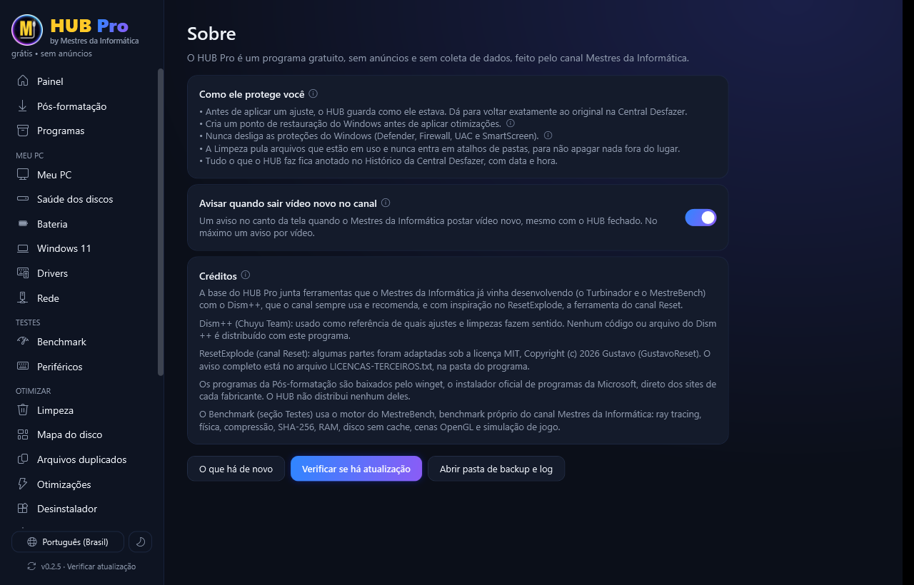

Versão, créditos e onde ficam os backups e o log. Aqui também fica a chave **Avisar quando sair vídeo novo no canal**:
- Com ela ligada, o HUB mostra no Painel e no canto da tela quando o Mestres da Informática posta um vídeo novo, mesmo com o HUB fechado.
- É no máximo um aviso por vídeo, só entre 8h e 22h, e Shorts não contam.
- O HUB lê a lista pública de vídeos do canal no YouTube, sem conta e sem enviar nenhum dado do seu PC.

---

## Segurança em primeiro lugar

- Cria um **ponto de restauração** antes de mudar qualquer coisa.
- Todo ajuste guarda o valor original e pode ser desfeito na **Central Desfazer**.
- **Nunca** desliga o Windows Defender, o Firewall, o UAC, o SmartScreen, o Windows Update ou a Microsoft Store.
- Arquivos do usuário só são apagados pela **Lixeira**, e só o que você marcou.
- Backups e arquivos usados como administrador ficam numa **pasta protegida**, onde outros programas não mexem.
- As ferramentas do Windows são chamadas pelo caminho completo, e as atualizações do próprio HUB são conferidas (SHA-256) antes de instalar.

## Privacidade

- O HUB Pro **não coleta dados** e não tem anúncios.
- O relatório do Meu PC não leva o seu nome, o nome do PC, números de série, IP ou senhas.
- A internet só é usada quando a função precisa: procurar atualizações (GitHub), instalar e atualizar programas (winget), drivers, teste de internet, a página de Sugestões e o aviso de vídeo novo (lista pública do YouTube).

## Perguntas comuns

**O HUB Pro é gratuito mesmo?** Sim. É gratuito, sem anúncios e sem versão paga.

**Precisa de internet?** Só para as funções que baixam algo (programas, drivers, atualizações) e para o teste de rede. Limpeza, análise, reparos e a maior parte das telas funcionam sem internet.

**Posso desfazer o que o HUB fez?** Sim. Ajustes e programas da inicialização voltam pela **Central Desfazer**, e o ponto de restauração volta o Windows inteiro para antes.

**Como desligo os avisos de vídeo novo?** Na tela **Sobre**, desligue a chave **Avisar quando sair vídeo novo no canal**. Desinstalar o HUB também apaga a tarefa agendada desses avisos.

## Sugestões e problemas

Use a página **Sugestões** dentro do próprio HUB Pro: a mensagem chega direto para o canal.

## Mestres da Informática

[YouTube](https://www.youtube.com/c/mestresdainformatica) ·
[Seja membro](https://www.youtube.com/channel/UCNblNh-u0nu5mtXT84Wgdiw/join) ·
[Instagram](https://www.instagram.com/mestresdainformatica/) ·
[Threads](https://www.threads.com/@mestresdainformatica) ·
[Facebook](https://www.facebook.com/mestresdainformaticaoficial) ·
[Site](https://mestresdainformatica.com.br/)

---

© 2026 Mestres da Informática. A base do HUB Pro junta ferramentas próprias do canal (Turbinador e MestreBench), o Dism++ como referência e inspiração no ResetExplode, do canal Reset — veja [LICENCAS-TERCEIROS.txt](LICENCAS-TERCEIROS.txt).
