

# HUB Pro
### by Mestres da Informática

**A central gratuita para cuidar do seu PC: em português e sem coleta de dados.**

&nbsp;

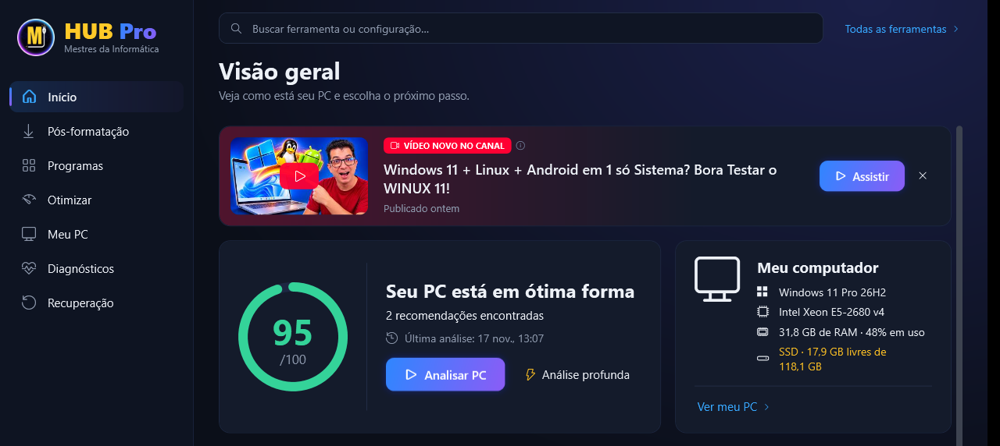

---

## Índice

- [Como baixar e instalar](#como-baixar-e-instalar)
- [Novidades da versão 0.3.33](#novidades-da-versão-0333) · [Versões anteriores](#versões-anteriores)
- [Guia de cada tela](#guia-de-cada-tela)
  - **Início:** [Visão geral](#visão-geral) · [Todas as ferramentas](#todas-as-ferramentas)
  - [Pós-formatação](#pós-formatação)
  - **Programas:** [Instalar](#instalar-programas) · [Atualizar](#atualizar-programas) · [Desinstalar](#desinstalar-programas) · [Apps do Windows](#apps-do-windows)
  - **Otimizar:** [Limpeza](#limpeza) · [Ajustes](#ajustes-do-windows) · [Inicialização](#inicialização) · [Mapa do disco](#mapa-do-disco) · [Arquivos duplicados](#arquivos-duplicados)
  - **Meu PC:** [Visão geral](#meu-pc) · [Saúde dos discos](#saúde-dos-discos) · [Otimizar discos](#otimizar-discos) · [Drivers](#drivers) · [Bateria](#bateria) · [Windows 11](#windows-11)
  - **Diagnósticos:** [Internet](#teste-de-internet) · [Benchmark](#benchmark) · [Periféricos](#periféricos) · [Pendrive original](#pendrive-cartão-ou-hd-externo-falsificado)
  - **Recuperação:** [Reparar o Windows](#reparar-o-windows) · [Pontos de restauração](#pontos-de-restauração) · [Central Desfazer](#central-desfazer) · [Backup para formatar](#backup-para-formatar)
  - **Configurações:** [Geral](#configurações) · [Acessibilidade](#acessibilidade) · [Sobre](#sobre) · [Licenças e privacidade](#licenças-e-privacidade) · [Sugestões](#sugestões)
- [Segurança em primeiro lugar](#segurança-em-primeiro-lugar)
- [Privacidade](#privacidade)
- [Perguntas comuns](#perguntas-comuns)

---

## Como baixar e instalar

1. Clique em **[Baixar o HUB Pro](https://github.com/mestresdainformatica/HUB-Pro/releases/latest)**.
2. Em **Assets**, baixe o **`HUB-Pro-Setup-...exe`** (instalador). Se preferir usar sem instalar, baixe o `MestresHub.exe` (versão portátil).
3. Abra e siga o instalador. O HUB Pro pede permissão de administrador porque mexe nas configurações do Windows.

> **O Windows mostrou "O Windows protegeu o computador"?** Isso aparece em programas novos que ainda não têm assinatura digital paga. Clique em **Mais informações → Executar assim mesmo**. Baixe sempre **só por esta página** ou pelos links do canal.

> **O antivírus barrou o HUB?** Alguns antivírus (Norton, Avast, AVG, Bitdefender) desconfiam de programas novos e sem assinatura digital que mexem no Windows. É um falso positivo: restaure o arquivo da quarentena e coloque a pasta do HUB nas exceções do antivírus.

**Já tem o HUB?** Ele avisa sozinho quando sai uma versão nova e se atualiza em um clique, sem baixar de novo. Antes de instalar, ele confere o arquivo baixado (SHA-256). Depois de atualizar, a janela **"O que há de novo"** mostra tudo o que mudou desde a sua versão.

**Requisitos:** Windows 10 (1809 ou mais novo) ou Windows 11, 64 bits.

**Idiomas:** português do Brasil, português de Portugal, español e English. Na primeira vez, o HUB abre no idioma e no tema (claro ou escuro) do Windows. Para trocar, vá em **Configurações**.

---

## Novidades da versão 0.3.33

A maior mudança de visual do HUB Pro até agora, junto com a correção dos problemas que vocês mandaram pela página de Sugestões.

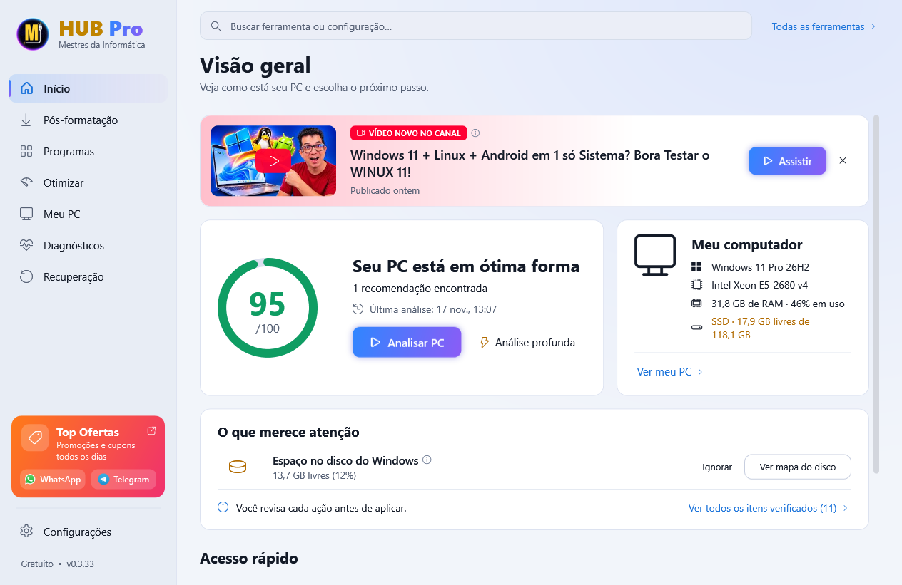

**Visual novo**
- **Menu com 7 áreas:** Início, Pós-formatação, Programas, Otimizar, Meu PC, Diagnósticos e Recuperação, cada uma com suas abas. Tudo ficou mais limpo e fácil de ler, no tema escuro e no claro.
- **Busca no alto da tela:** digite o que quer fazer (por exemplo: *limpar*, *drivers*, *restaurar*) e abra a ferramenta direto. Atalho: **Ctrl + F**.
- **Todas as ferramentas:** uma tela com todas as funções do HUB, separadas por área.
- **Migalhas** no alto de cada tela (Início › Otimizar › Limpeza), para saber onde você está e voltar com um clique.
- **Configurações num lugar só:** tema (Sistema, Claro ou Escuro), idioma, aviso de vídeo novo, acessibilidade e o Sobre.

**Novidades**
- **Visão geral:** o último vídeo do canal aparece em destaque no topo, a nota do PC fica ao lado de "Meu computador" e o **"O que merece atenção"** traz o botão certo para cada problema.
- **Corrigir tudo** abre uma tela de revisão: você escolhe item por item o que corrigir e acompanha cada um, com ponto de restauração antes.
- **Pós-formatação:** barra com as 7 etapas, cartão "Seu plano" e telas de revisão, andamento e conclusão. Depois de reiniciar, o HUB volta exatamente de onde parou.
- **Windows 11:** quando o processador não é compatível, a tela mostra os vídeos do canal que ensinam a instalar o Windows 11 mesmo assim.
- **Top Ofertas** no menu lateral: promoções e cupons do dia, com atalho para o canal do WhatsApp e o grupo do Telegram.
- **Sobre** reúne numa página só a versão, o canal e as redes, o Top Ofertas, os parceiros com cupom e o envio de sugestões.

**Correções** (muitas vieram dos e-mails de vocês)
- **Reparar o Windows:** quando o próprio DISM da Microsoft não consegue consertar a imagem (comum no Windows 11 novo), o HUB explica o motivo, para de repetir o mesmo reparo e mostra a reinstalação pelo Windows Update, que mantém seus arquivos e programas.
- **Ponto de restauração:** o HUB espera no máximo 5 minutos e dá para seguir sem ele.
- **Atualização do HUB:** quando o GitHub limita os pedidos, o HUB usa um caminho reserva e explica o que aconteceu.
- **Jogos da Steam, Epic e outros launchers** agora são desinstalados pelo próprio launcher, sem apagar arquivos por fora.
- **Limpeza:** tempo máximo por item, contador de arquivos e Parar que responde; mostra o espaço livre antes e depois.
- **Otimizar internet:** espera a conexão estabilizar e testa de novo antes de dizer que piorou.
- **Meu PC:** a virtualização aparece certa quando o Windows já usa (Hyper-V / Segurança baseada em virtualização).
- **Bateria:** cálculo corrigido para notebooks com duas baterias.
- **Drivers:** botão **Ignorar este aparelho**, para peças queimadas ou desligadas de propósito.
- **Inicialização:** mostra a data da última medição do Windows; as mudanças só valem quando você clica em **Aplicar**.
- **Programas:** depois de instalar, **Voltar ao catálogo** leva de volta à lista; programas sem uso há meses não são mais atualizados pelo Corrigir tudo.
- **Revisão completa do visual:** textos cortados, colunas desalinhadas, telas que não cabiam em janela pequena, botões repetidos e textos em espanhol revisados.

---

## Versões anteriores

Novidades da versão 0.3.23

- **Duas análises no Painel:** a rápida (menos de um minuto) e a **Análise profunda** (15 a 40 minutos), com Saúde do Windows, otimização dos SSDs e HDs, apps removidos que voltaram e programas sem uso.
- **Pós-formatação** com perfis prontos **Leve, Equilibrado e Extremo**.
- **Reparar o Windows** com botão **Verificar** e o reparo **Acertar a data e a hora**.
- **Limpeza** com **Liberar memória RAM**; **Otimizações** com 69 ajustes (Copilot, Recall, Widgets, propaganda do Iniciar...).
- **Teste de controle de videogame** em Periféricos e **Otimizar discos** (TRIM no SSD, desfragmentação no HD).
- **Teste de internet** medido do jeito do Speedtest, com servidor e cidade.
- **Tamanho da letra**, leitor de tela (NVDA, Narrador) e botão **Voltar**.
- Bloatware que voltava depois de atualizar o Windows agora sai também da cópia para novos usuários.

Novidades das versões 0.2.5 a 0.2.9

- **0.2.9:** ícones de verdade na busca de programas; aviso de "sem internet" ao verificar atualização.
- **0.2.8:** textos revisados; aviso no teste completo de pendrive; explicações novas no Benchmark.
- **0.2.7 e 0.2.6:** novo envio de Sugestões, com proteção contra spam; aviso de vídeo novo mais confiável.
- **0.2.5:** telas novas de Backup para formatar, Reparar o Windows, Pontos de restauração, Mapa do disco, Arquivos duplicados, Bateria, Windows 11, Periféricos e pendrive falsificado.

---

## Guia de cada tela

## Início

### Visão geral

A tela inicial. No topo aparece o vídeo mais recente do canal. Um clique em **Analisar PC** confere o computador em menos de um minuto e dá uma **nota de saúde de 0 a 100**. A conferência cobre:
- arquivos inúteis e programas que abrem com o Windows;
- ajustes recomendados e apps removidos que voltaram;
- saúde do Windows (inclusive a data e a hora), drivers e saúde dos discos;
- otimização dos SSDs e HDs e espaço livre;
- programas desatualizados e programas sem uso.

**O que merece atenção** lista só o que precisa de você, cada item com o botão da tela certa para resolver e **Ignorar**. O botão **Corrigir tudo** abre uma revisão: você escolhe o que corrigir, o HUB cria um ponto de restauração e corrige um item por vez. A **Análise profunda** (15 a 40 minutos) confere a fundo os arquivos do Windows e o disco.

---

### Todas as ferramentas

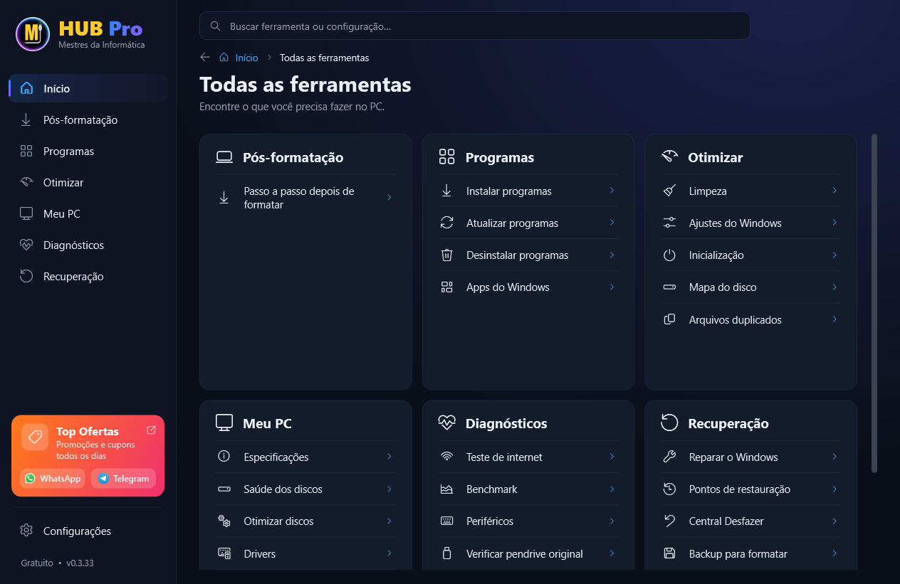

Todas as funções do HUB numa tela só, separadas pelas mesmas áreas do menu. Também dá para achar qualquer ferramenta pela **busca** no alto da tela (**Ctrl + F**).

---

## Pós-formatação

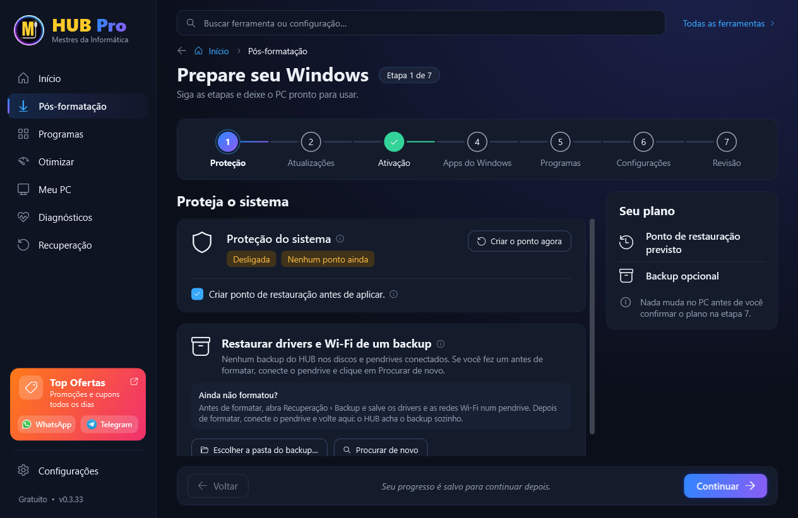

Tudo para depois de formatar, em 7 etapas e na ordem certa: proteção do sistema, Windows Update, ativação, limpar o Windows (apps de propaganda), programas, configurações e revisão.

Os programas são instalados pelo instalador oficial da Microsoft (winget), direto do site de cada fabricante e **já em português**. Nas etapas 4 e 6, os perfis **Leve, Equilibrado e Extremo** marcam os apps a remover e as configurações; tudo pode ser desmarcado e desfeito depois.

**Como usar:** siga as etapas pela barra do alto, marque o que quer e revise o plano antes de executar. Se o PC precisar reiniciar, o HUB volta exatamente de onde parou. Se você fez o [Backup para formatar](#backup-para-formatar), a primeira etapa acha o backup e devolve os drivers e as redes Wi-Fi.

---

## Programas

### Instalar programas

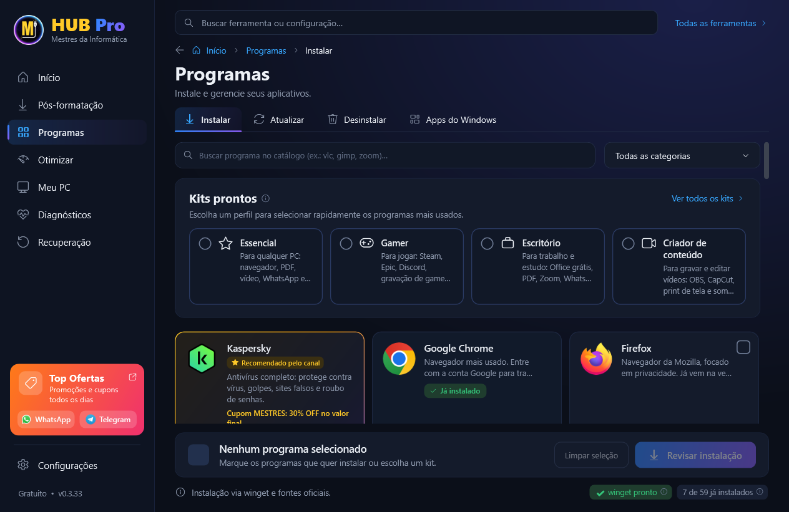

Instale programas com um clique. Há kits prontos (Essencial, Gamer, Escritório, Criador de conteúdo, Programador e Técnico), e a busca procura em todo o catálogo do winget e da Microsoft Store, com as versões em português primeiro.

### Atualizar programas

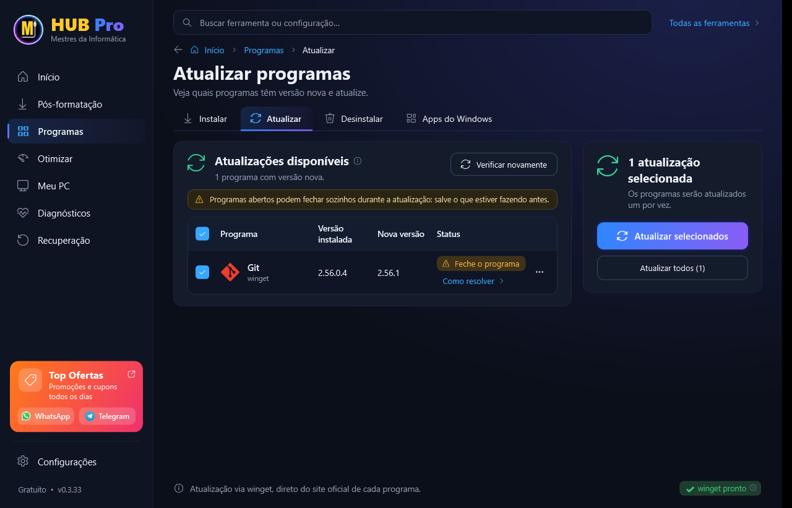

Mostra quais programas têm versão nova. Marque o que quer atualizar e clique em **Atualizar selecionados**: o HUB atualiza um por vez e avisa quando algum programa aberto impede a atualização.

### Desinstalar programas

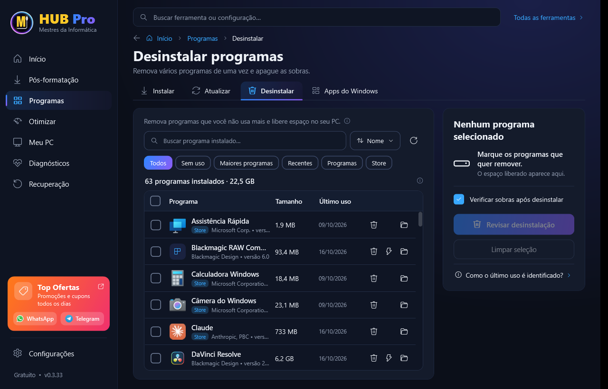

Desinstala vários programas de uma vez e apaga as sobras. O filtro **Sem uso** mostra o que você não abre há meses. Jogos da Steam, Epic e outros launchers são desinstalados pelo próprio launcher.

### Apps do Windows

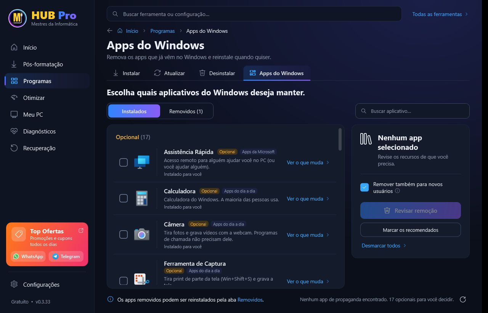

Remove os apps de propaganda que já vêm no Windows, também para os novos usuários, para eles não voltarem nas atualizações. Cada app tem selo (**Pode remover**, **Opcional** ou **Não remova**, que o HUB nem deixa marcar) e **Ver o que muda**. Dá para reinstalar qualquer um pela aba **Removidos**.

---

## Otimizar

### Limpeza

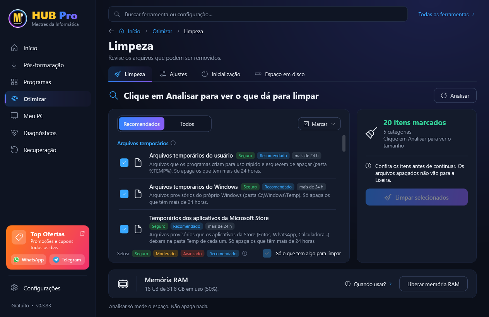

Libera espaço apagando o que o PC não precisa mais: arquivos temporários, caches e restos de atualizações. Seus documentos, fotos e senhas **nunca** são tocados.

**Como usar:** clique em **Analisar**, confira os itens (os **Recomendados** já vêm marcados) e clique em **Limpar selecionados**. **Liberar memória RAM** devolve ao Windows a memória parada dos programas abertos, sem fechar nenhum.

### Ajustes do Windows

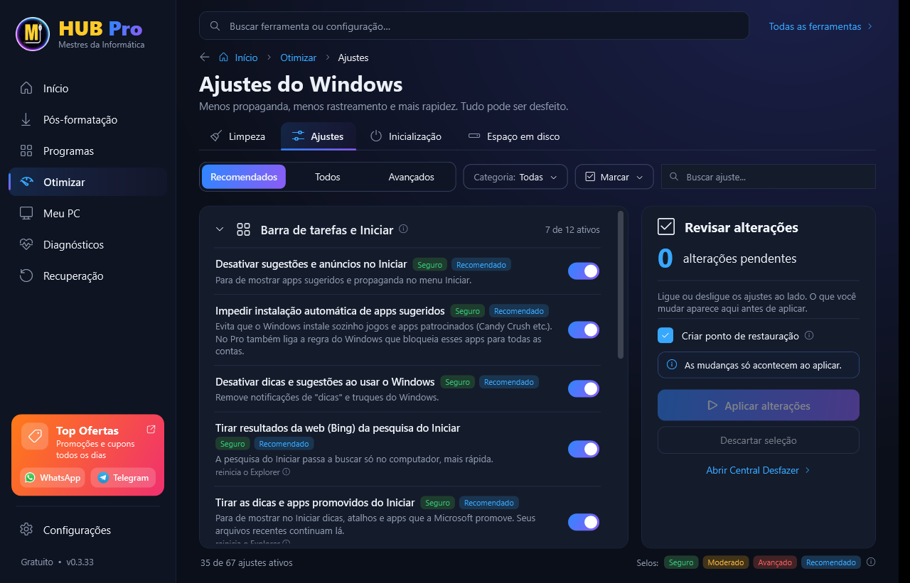

**69 ajustes** que deixam o Windows mais rápido, limpo e com menos propaganda e rastreamento: barra de tarefas e Iniciar, Explorador, inteligência artificial do Windows (Copilot, Recall), propaganda e sugestões, privacidade, desempenho e jogos, serviços e aparência. Cada ajuste tem selo (Seguro, Moderado, Avançado, Recomendado) e explicação. Nada muda até você clicar em **Aplicar**, e tudo pode ser desfeito na [Central Desfazer](#central-desfazer).

### Inicialização

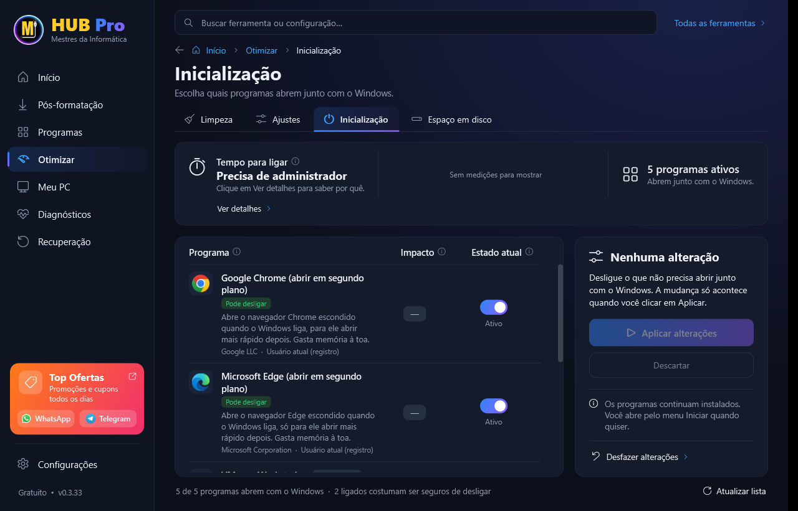

Mostra **quanto tempo o Windows leva para ligar**, com o gráfico das últimas vezes, e os programas que abrem junto com o Windows, cada um com selo dizendo se é seguro desligar. As mudanças só valem quando você clica em **Aplicar**.

### Mapa do disco

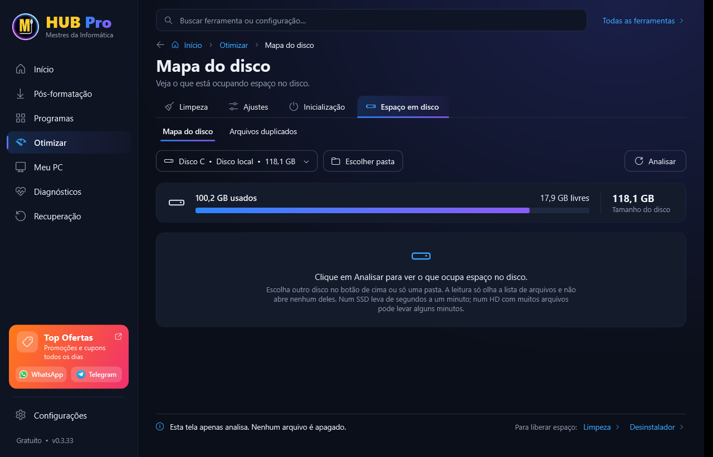

Mostra num mapa de blocos quais pastas e arquivos estão enchendo o disco, com a lista das maiores pastas e arquivos. **Só olha: nada é apagado.**

### Arquivos duplicados

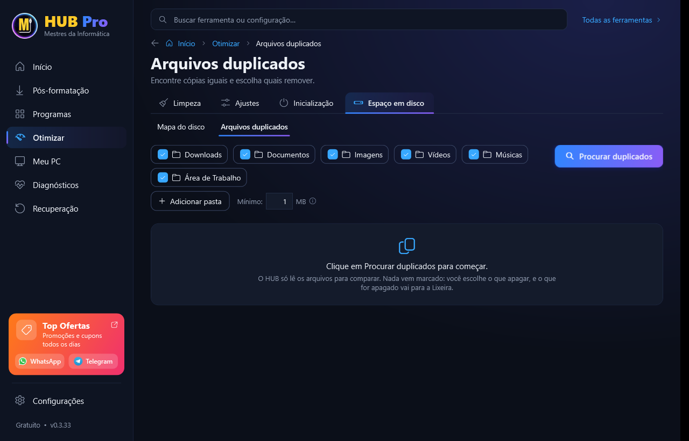

Acha cópias iguais do mesmo arquivo, mesmo com nomes diferentes (a comparação é pelo conteúdo). **Nada vem marcado**, o que for apagado vai para a **Lixeira**, e o HUB nunca deixa apagar todas as cópias de um arquivo.

---

## Meu PC

### Meu PC

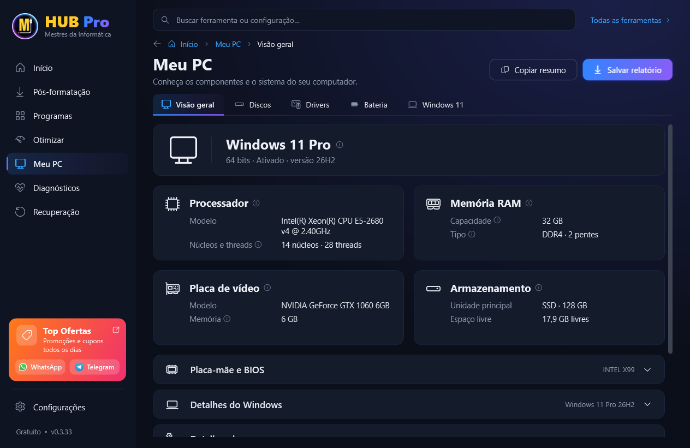

Tudo o que tem dentro do computador: Windows, placa-mãe, processador, memória, placa de vídeo e discos. Só leitura. **Copiar resumo** gera um texto para colar no comentário do YouTube ou no WhatsApp quando for pedir ajuda; **Salvar relatório** traz todos os detalhes. **O relatório não leva o seu nome, o nome do PC nem números de série.**

### Saúde dos discos

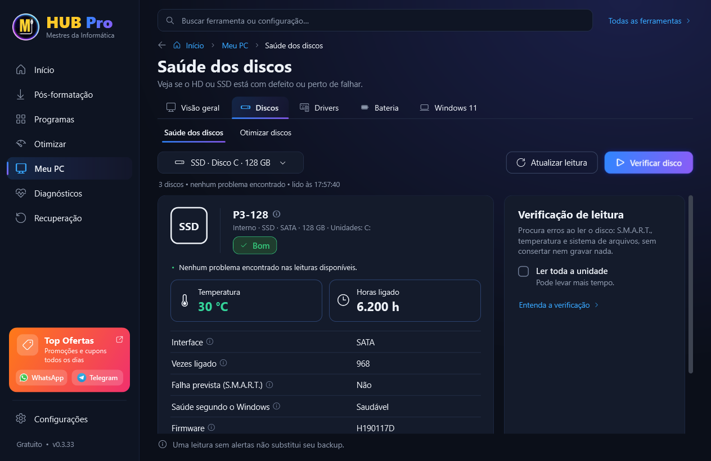

Mostra se cada HD, SSD, HD externo, pendrive e cartão está saudável: temperatura, desgaste e avisos de falha (S.M.A.R.T.). O **Teste de leitura** lê o disco inteiro e acha setores com defeito.

### Otimizar discos

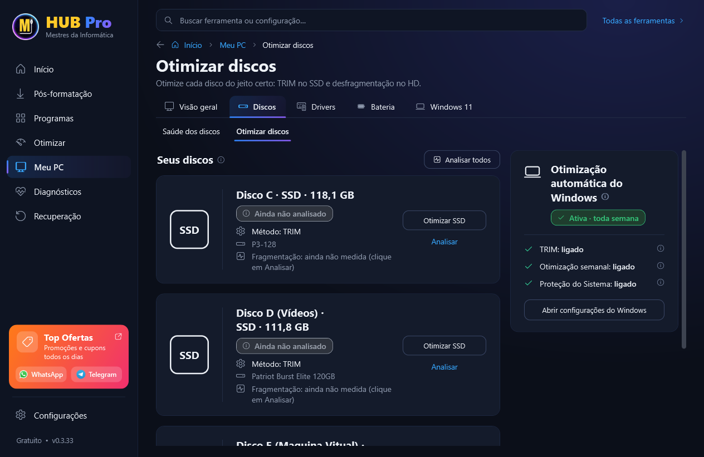

Trata cada disco do jeito certo: o SSD recebe TRIM e o HD, desfragmentação. Também liga de volta a otimização semanal do Windows, se estiver desligada.

### Drivers

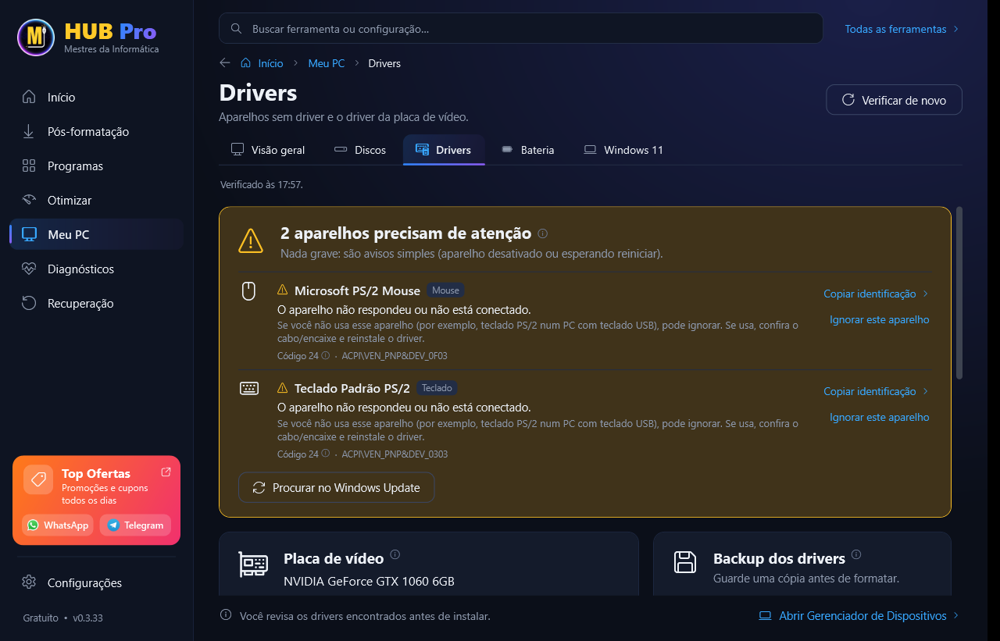

Mostra os aparelhos sem driver ou com defeito, procura drivers pelo **Windows Update**, instala o driver da placa de vídeo **NVIDIA, AMD ou Intel** pelo instalador oficial e faz **backup e restauração dos drivers**. Peças queimadas ou desligadas de propósito podem ser ignoradas.

### Bateria

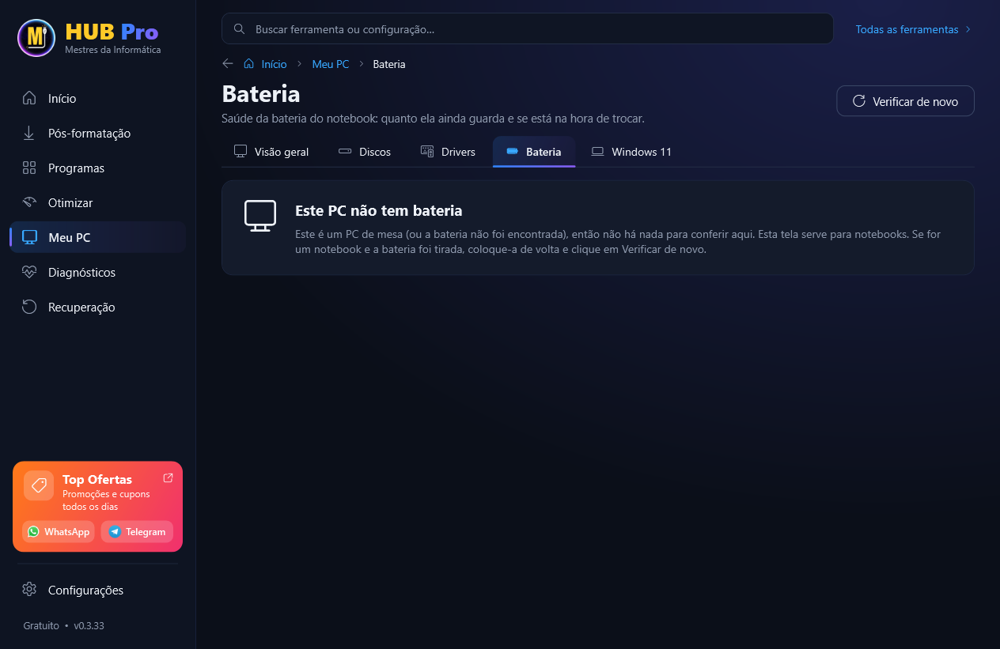

Para notebooks: quanto a bateria ainda guarda comparado com quando era nova, quantos ciclos ela já fez e se está na hora de trocar.

### Windows 11

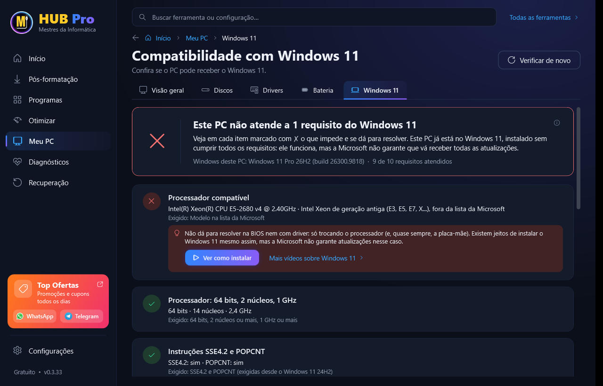

Confere, item por item, se o PC atende aos requisitos do Windows 11: processador, SSE4.2/POPCNT, memória, armazenamento, UEFI, Inicialização Segura, TPM 2.0, DirectX 12 e tela. Cada item com ✗ diz o que fazer. Quando o processador não é compatível, o botão **Ver como instalar** abre o vídeo do canal que ensina a instalar o Windows 11 mesmo assim, e **Mais vídeos sobre Windows 11** mostra todos os vídeos do canal sobre o assunto.

---

## Diagnósticos

### Teste de internet

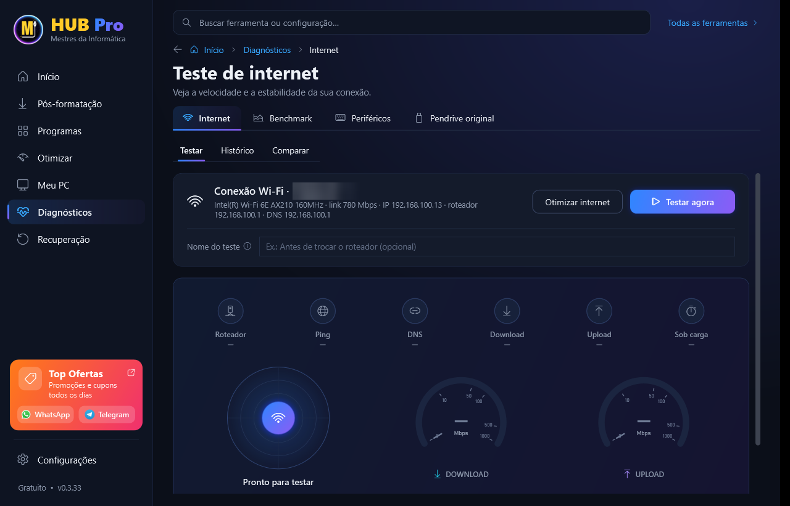

Mostra **onde está o problema**: no Wi-Fi/cabo, no roteador ou no provedor. Mede download e upload do jeito do Speedtest, o ping até a sua operadora e até a internet, DNS, perda de pacotes e variação. Cada teste fica no **Histórico** para comparar antes e depois. **Otimizar internet** escolhe o melhor DNS e mostra tudo antes de mudar, com **Reverter**.

### Benchmark

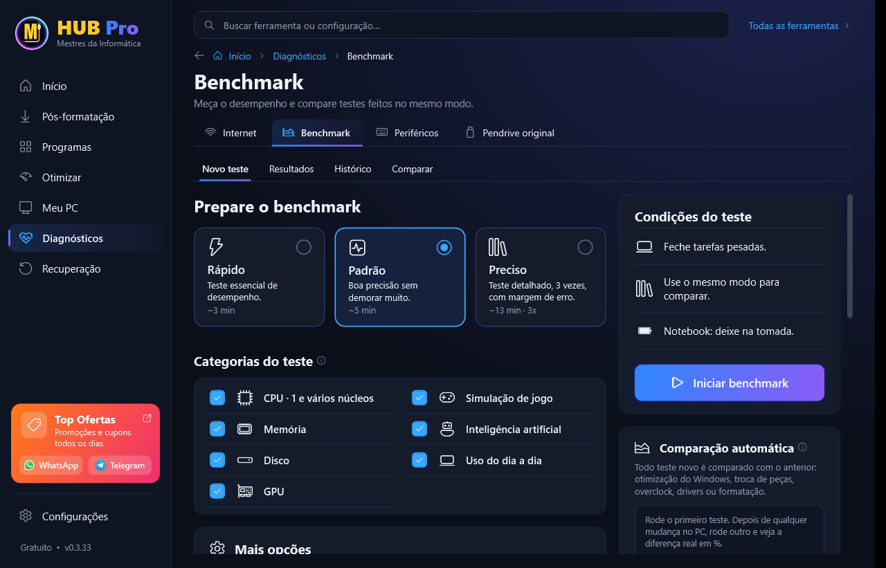

Mede a velocidade real do PC em 8 categorias (processador, memória, disco, placa de vídeo, jogo, inteligência artificial e uso do dia a dia). **1.000 pontos = um PC médio de hoje.** Rode um teste, faça a mudança no PC e rode de novo: a diferença aparece em **Comparar**.

### Periféricos

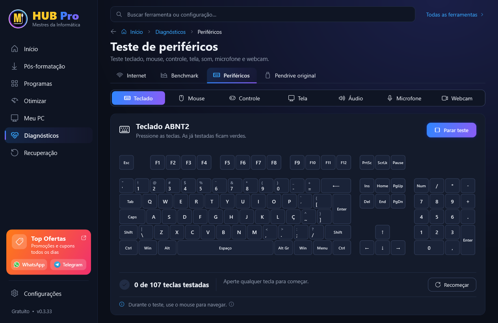

Testa teclado (desenho ABNT2), mouse, controle de videogame (Xbox, PlayStation, Switch Pro e genéricos), tela (pixels mortos), alto-falantes, microfone e webcam. Nada é alterado no PC.

### Pendrive, cartão ou HD externo falsificado

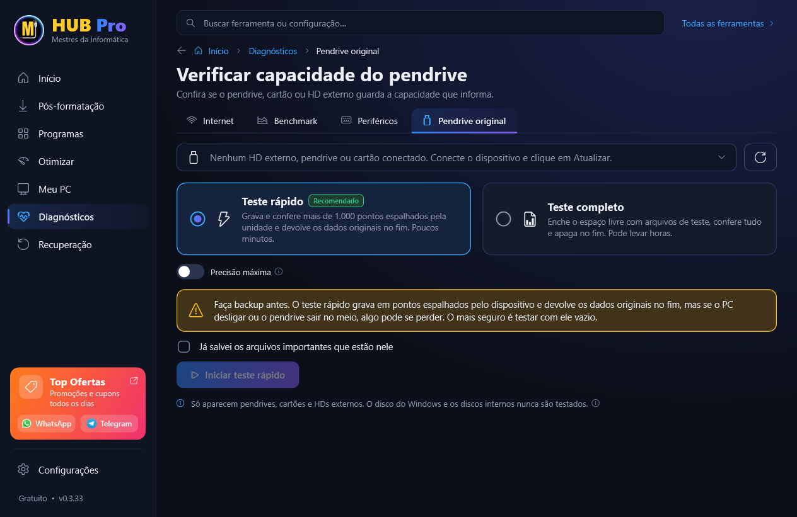

Muitos pendrives e cartões vendidos como "1 TB" guardam só alguns GB. O **Teste rápido** grava e confere mais de 1.000 pontos e mostra **quanto o aparelho guarda de verdade**; o **Teste completo** enche o espaço livre e confere tudo. O disco do Windows e os discos internos nunca são testados.

---

## Recuperação

### Reparar o Windows

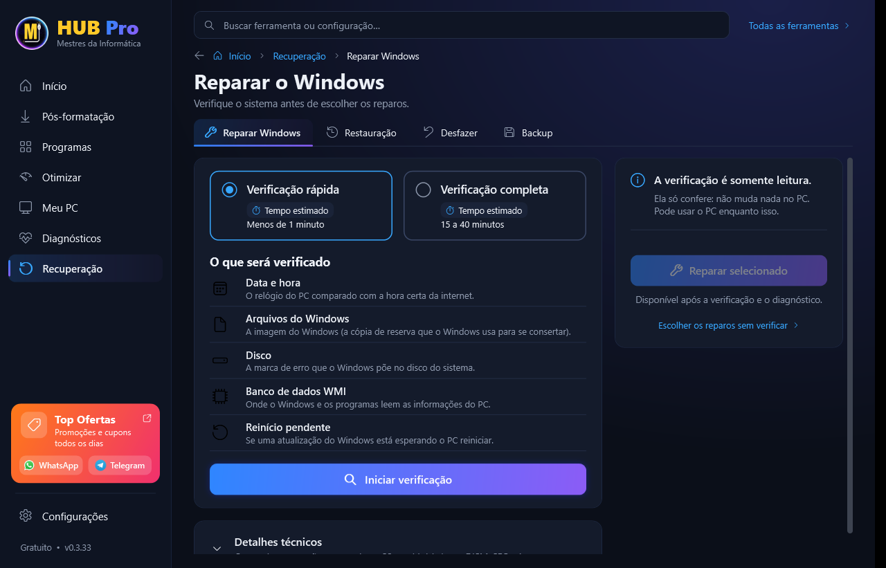

Conserta erros do próprio Windows com as ferramentas oficiais da Microsoft (data e hora, disco, DISM e SFC, WMI, cache de ícones e internet). O botão **Verificar** confere se há defeito sem mudar nada e deixa marcado só o reparo que resolve. Quando o DISM da Microsoft não consegue consertar, o HUB explica e mostra a reinstalação pelo Windows Update, que mantém seus arquivos.

### Pontos de restauração

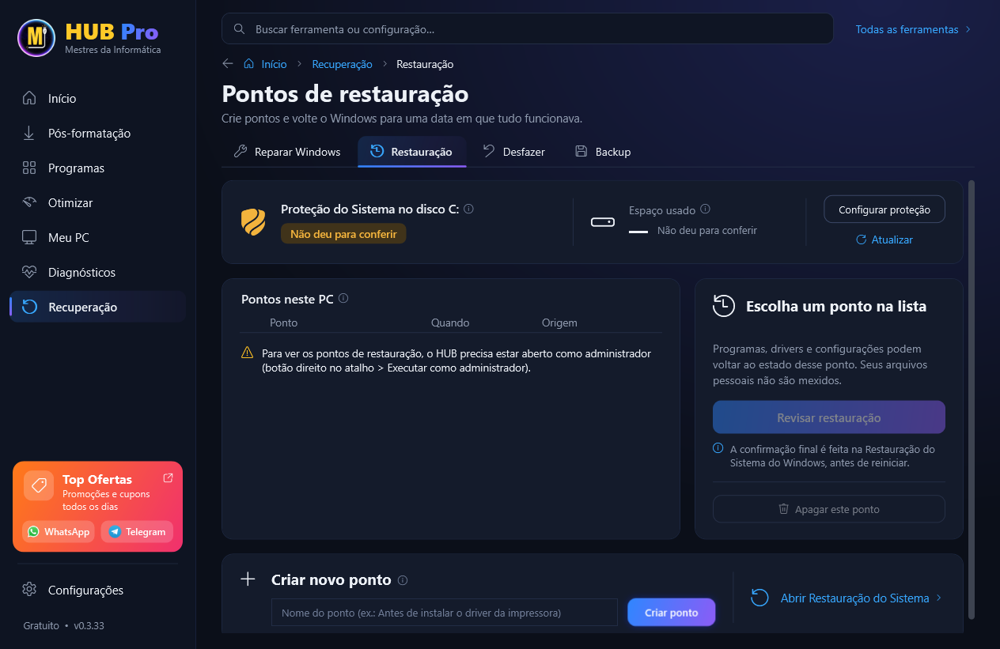

Veja os pontos de restauração, o espaço que eles usam e se a proteção está ligada. Crie um ponto com o nome que quiser antes de instalar algo desconhecido e volte para ele se o PC ficar com problema.

### Central Desfazer

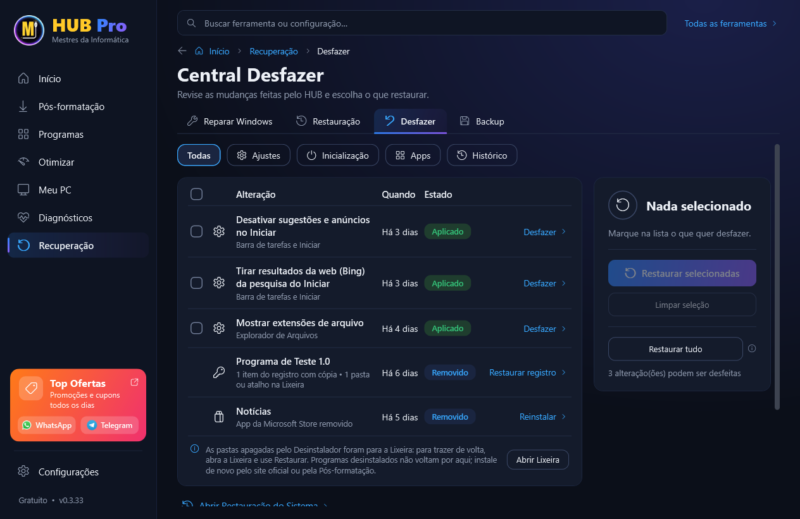

Lista tudo o que o HUB mudou no PC (ajustes, inicialização, apps e desinstalações) e volta cada coisa como era. Marque um ou vários itens e use **Restaurar selecionadas**.

### Backup para formatar

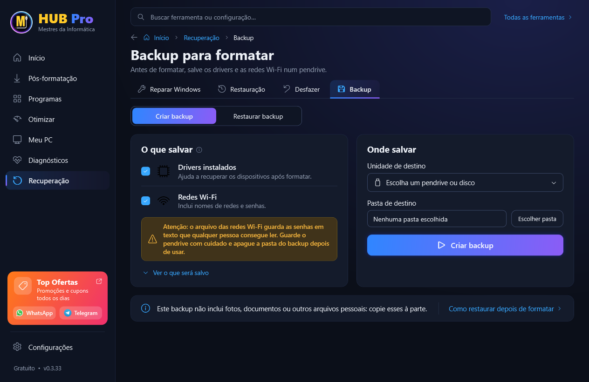

Antes de formatar, salve **os drivers e as redes Wi-Fi (com as senhas)** num pendrive. Depois de formatar, a Pós-formatação acha o backup e devolve tudo com um clique. O arquivo das redes guarda as senhas em texto legível: guarde o pendrive com cuidado. Fotos e documentos não entram neste backup.

---

## Configurações

### Configurações

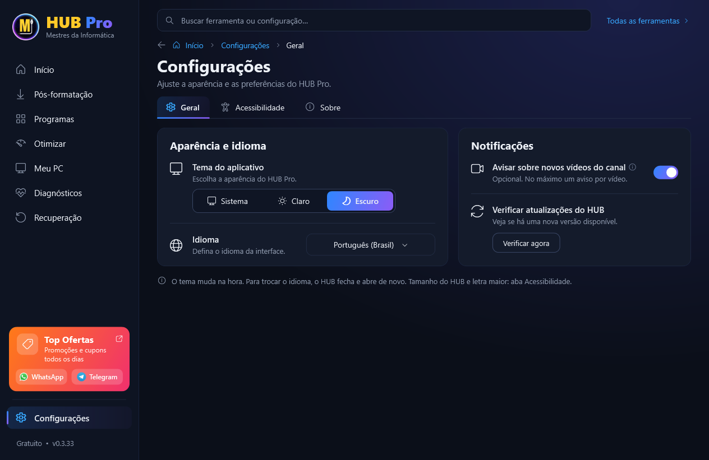

Tema (Sistema, Claro ou Escuro, troca na hora), idioma, aviso de vídeo novo do canal e verificação de atualizações.

### Acessibilidade

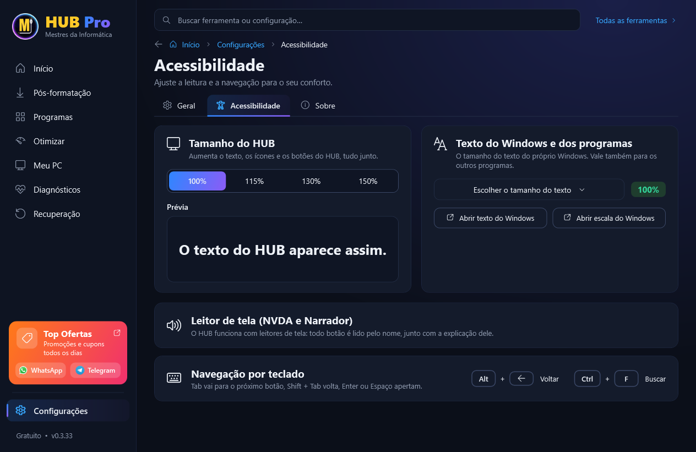

- **Tamanho do HUB** (100% a 150%), com prévia, e atalhos para o tamanho do texto e a escala da tela do Windows.
- **Leitor de tela:** com o NVDA ou o Narrador, cada botão é lido pelo nome, com a dica junto.
- **Atalhos:** Ctrl + F abre a busca; a seta no alto da tela, o botão lateral do mouse e **Alt + seta para a esquerda** voltam para a tela anterior.

### Sobre

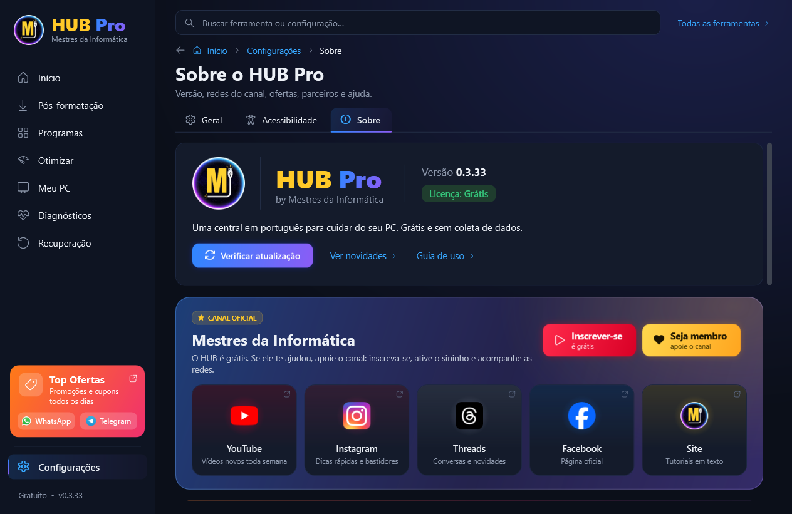

Versão, **Verificar atualização** e **Ver novidades**, o canal e as redes sociais, o **Top Ofertas** (canal do WhatsApp e grupo do Telegram), os parceiros com cupom de desconto e o envio de sugestões.

### Licenças e privacidade

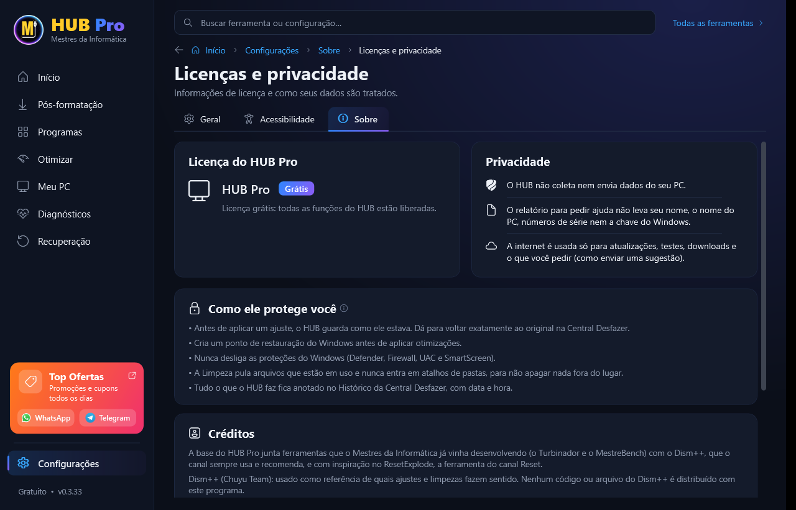

A licença do HUB Pro (grátis, com todas as funções liberadas), os créditos de terceiros e o que o HUB usa da internet.

### Sugestões

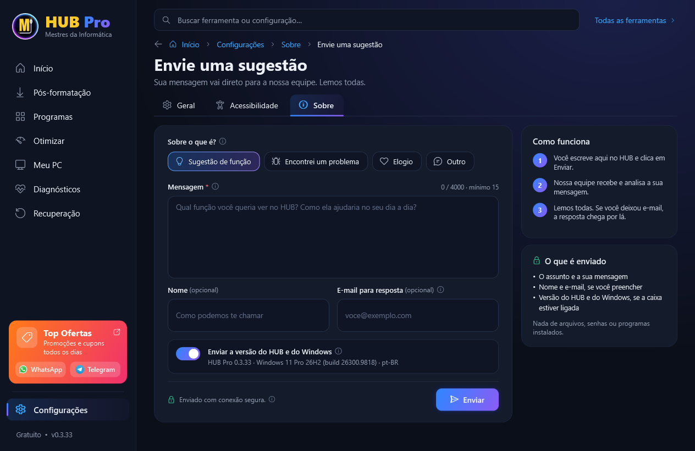

Mande uma ideia, avise de um problema ou mande um elogio direto para o canal. A nossa equipe lê todas as mensagens.

---

## Segurança em primeiro lugar

- Cria um **ponto de restauração** antes de mudar qualquer coisa.
- Todo ajuste guarda o valor original e pode ser desfeito na **Central Desfazer**.
- **Nunca** desliga o Windows Defender, o Firewall, o UAC, o SmartScreen, o Windows Update ou a Microsoft Store.
- As análises e verificações **só leem**: nada muda no PC até você mandar corrigir.
- Arquivos do usuário só são apagados pela **Lixeira**, e só o que você marcou.
- Os reparos e o Windows Update têm limite de tempo e podem ser parados com segurança.
- Backups e arquivos usados como administrador ficam numa **pasta protegida**.
- As atualizações do próprio HUB são conferidas (SHA-256) antes de instalar.

## Privacidade

- O HUB Pro **não coleta dados**.
- O relatório do Meu PC não leva o seu nome, o nome do PC, números de série, IP, nome do Wi-Fi ou senhas.
- A internet só é usada quando a função precisa: atualizações do HUB (GitHub), programas (winget e Microsoft Store), drivers, teste de internet (Cloudflare), hora certa, Sugestões e o aviso de vídeo novo (lista pública do YouTube).

## Perguntas comuns

**O HUB Pro é gratuito mesmo?** Sim. A licença é grátis e todas as funções estão liberadas.

**Como atualizo?** O HUB avisa sozinho quando sai uma versão nova. É só aceitar o aviso: ele baixa, confere e instala, sem precisar baixar de novo por aqui.

**Precisa de internet?** Só para as funções que baixam algo (programas, drivers, atualizações), para o teste de rede e para acertar a hora.

**Posso desfazer o que o HUB fez?** Sim. Ajustes, inicialização e apps voltam pela **Central Desfazer**, e o ponto de restauração volta o Windows inteiro para antes.

**O teste de internet do HUB dá diferente do Speedtest. Qual está certo?** Os dois. A medição é feita do mesmo jeito; diferenças pequenas acontecem porque a internet varia de um minuto para o outro e os servidores ficam em lugares diferentes.

**Como desligo os avisos de vídeo novo?** Em **Configurações › Geral**, desligue **Avisar sobre novos vídeos do canal**.

## Sugestões e problemas

Use a página **Sugestões** dentro do próprio HUB Pro (Configurações › Sobre › Enviar mensagem): a mensagem chega direto para o canal.

## Mestres da Informática

[YouTube](https://www.youtube.com/c/mestresdainformatica) ·
[Seja membro](https://www.youtube.com/channel/UCNblNh-u0nu5mtXT84Wgdiw/join) ·
[Instagram](https://www.instagram.com/mestresdainformatica/) ·
[Threads](https://www.threads.com/@mestresdainformatica) ·
[Facebook](https://www.facebook.com/mestresdainformaticaoficial) ·
[Site](https://mestresdainformatica.com.br/) ·
[Top Ofertas](https://mestresdainformatica.com.br/ofertas/)

---

© 2026 Mestres da Informática. A base do HUB Pro junta ferramentas próprias do canal (Turbinador e MestreBench), o Dism++ como referência e inspiração no ResetExplode, do canal Reset — veja [LICENCAS-TERCEIROS.txt](LICENCAS-TERCEIROS.txt).
