

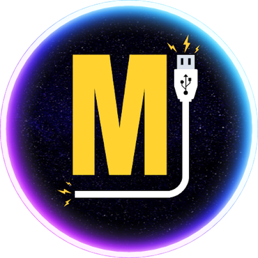

# HUB Pro
### by Mestres da Informática

**A central gratuita para cuidar do seu PC: em português, sem anúncios e sem coleta de dados.**

&nbsp;

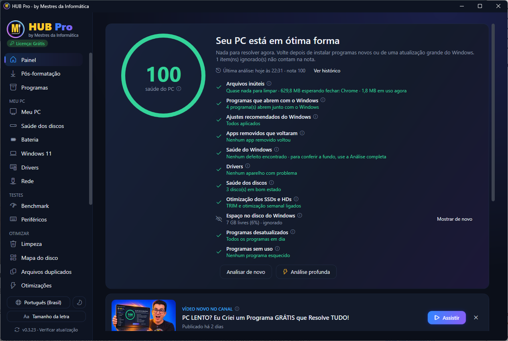

---

## Índice

- [Como baixar e instalar](#como-baixar-e-instalar)
- [Novidades da versão 0.3.23](#novidades-da-versão-0323) · [Versões anteriores](#versões-anteriores)
- [Guia de cada tela](#guia-de-cada-tela)
  - [Painel](#painel) · [Pós-formatação](#pós-formatação) · [Programas](#programas)
  - **Meu PC:** [Meu PC](#meu-pc) · [Saúde dos discos](#saúde-dos-discos) · [Pendrive falsificado](#pendrive-cartão-ou-hd-externo-falsificado) · [Bateria](#bateria) · [Windows 11](#windows-11) · [Drivers](#drivers) · [Rede](#rede)
  - **Testes:** [Benchmark](#benchmark) · [Periféricos](#periféricos)
  - **Otimizar:** [Limpeza](#limpeza) · [Mapa do disco](#mapa-do-disco) · [Arquivos duplicados](#arquivos-duplicados) · [Otimizações](#otimizações) · [Desinstalador](#desinstalador) · [Inicialização](#inicialização)
  - **Segurança:** [Reparar o Windows](#reparar-o-windows) · [Pontos de restauração](#pontos-de-restauração) · [Central Desfazer](#central-desfazer) · [Backup para formatar](#backup-para-formatar)
  - [Sobre, licença e avisos de vídeo novo](#sobre-licença-e-avisos-de-vídeo-novo)
- [Letra maior, leitor de tela e atalhos](#letra-maior-leitor-de-tela-e-atalhos)
- [Segurança em primeiro lugar](#segurança-em-primeiro-lugar)
- [Privacidade](#privacidade)
- [Perguntas comuns](#perguntas-comuns)

---

## Como baixar e instalar

1. Clique em **[Baixar o HUB Pro](https://github.com/mestresdainformatica/HUB-Pro/releases/latest)**.
2. Em **Assets**, baixe o **`HUB-Pro-Setup-...exe`** (instalador). Se preferir usar sem instalar, baixe o `MestresHub.exe` (versão portátil).
3. Abra e siga o instalador. O HUB Pro pede permissão de administrador porque mexe nas configurações do Windows.

> **O Windows mostrou "O Windows protegeu o computador"?** Isso aparece em programas novos que ainda não têm assinatura digital paga. Clique em **Mais informações → Executar assim mesmo**. Baixe sempre **só por esta página** ou pelos links do canal.

> **O antivírus barrou o HUB?** Alguns antivírus (Norton, Avast, AVG, Bitdefender) desconfiam de programas novos e sem assinatura digital que mexem no Windows. É um falso positivo: restaure o arquivo da quarentena e coloque a pasta do HUB nas exceções do antivírus. Desde a 0.3.23 o HUB roda os comandos do Windows de um jeito que os antivírus confundem bem menos.

**Atualizações:** o HUB Pro avisa sozinho quando sai uma versão nova e se atualiza em um clique. Antes de instalar, ele confere o arquivo baixado (SHA-256). Depois de atualizar, a janela **"O que há de novo"** mostra tudo o que mudou.

**Requisitos:** Windows 10 (1809 ou mais novo) ou Windows 11, 64 bits.

**Idiomas:** português do Brasil, português de Portugal, español e English. Na primeira vez, o HUB abre no idioma e no tema (claro ou escuro) do Windows. O tema troca na hora, com um clique no canto de baixo do menu.

---

## Novidades da versão 0.3.23

A maior atualização do HUB Pro até agora. Ela junta tudo o que mudou desde a 0.2.9, com muitas ideias que vieram dos comentários dos inscritos.

**Painel e Corrigir tudo**
- **Duas análises:** a **rápida** (menos de um minuto) e a **Análise profunda** (15 a 40 minutos), que confere a fundo a imagem do Windows, os arquivos do sistema, o disco e a fragmentação. Feita logo depois da rápida, a profunda só roda a parte que falta.
- **Verificações novas:** **Saúde do Windows** (defeitos no próprio Windows e relógio errado), **Otimização dos SSDs e HDs** (TRIM, otimização semanal e Proteção do Sistema), **Apps removidos que voltaram** e **Programas sem uso**.
- **Botão Parar análise.** Em cada item aparece o que está sendo conferido agora e há quanto tempo, para você ver que o HUB não travou.
- **Caixinha "Corrigir" em cada problema**, para escolher o que o HUB corrige. O **Corrigir tudo** vai de cima para baixo, um item por vez, e agora também atualiza os programas desatualizados.
- **Animação item por item:** o ponto de restauração vira a primeira linha da lista, com o tempo contando. Cada item mostra o que está sendo feito, e no fim o topo resume o que foi corrigido.
- Arquivos em uso e o cache de programas abertos (como o Chrome) não contam mais como problema: aparecem à parte, dizendo o que fazer.

**Pós-formatação**
- **Perfis prontos Leve, Equilibrado e Extremo (para PC fraco).** Um clique marca os apps a remover e as configurações, e dá para desmarcar o que quiser. Nenhum perfil mexe em antivírus, Firewall, Windows Update nem Microsoft Store.
- A etapa Configurações traz todos os ajustes da tela Otimizações (os recomendados já marcados). No fim, o HUB faz a verificação do PC no Painel.
- A caixinha que tira o Windows Update do "Executar tudo" fica logo abaixo do botão, fácil de achar.
- Os apps que vêm com o Windows aparecem com o ícone oficial de cada um.

**Funções novas**
- **Reparar o Windows:** botão **Verificar** (rápido ou completo). Ele confere se o Windows tem defeito sem mudar nada e deixa marcado só o reparo que resolve. Também tem o reparo novo **Acertar a data e a hora**.
- **Limpeza:** botão **Liberar memória RAM**, que devolve ao Windows a memória parada dos programas abertos sem fechar nenhum. Os itens demorados agora mostram tempo e porcentagem e têm botão **Parar**.
- **Otimizações:** 24 ajustes novos (69 no total), como desligar **Copilot, Recall e Widgets**, tirar propaganda do Iniciar, da tela de bloqueio e do Explorador, e mais privacidade. Também entram a **Barra de tarefas menor**, pela opção do próprio Windows, e os **Efeitos visuais leves**.
- **Saúde dos discos:** aba **Otimizar**, que trata cada disco do jeito certo (SSD com TRIM, HD com desfragmentação).
- **Periféricos:** visual novo e **teste de controle de videogame** (Xbox, PlayStation, Switch Pro e genéricos, por cabo ou Bluetooth), com botões, analógicos, drift, gatilhos e vibração.
- **Programas esquecidos:** o Painel e o Desinstalador mostram há quanto tempo você não abre cada programa, com o filtro **Sem uso**.
- **Programas novos no catálogo:** UniGetUI, OpenCode, Kilo Code, MiMo Code, Sucrose Wallpaper Engine e TranslucentTB.
- **Central Desfazer:** marque vários itens e use **Restaurar selecionados**.

**Teste de internet**
- Mede do jeito do Speedtest: mais conexões ao mesmo tempo, sem contar os primeiros segundos. Também mostra o **servidor e a cidade** usados.
- O cartão **Ping** mostra em destaque o ping até a **sua operadora**, como o Speedtest. Embaixo fica o ping até a internet, que é o lag dos jogos.
- O cartão DNS mede como o "Otimizar internet", com sites comuns. A comparação antes × depois leva em conta que a internet varia sozinha.

**Para todos**
- **Tamanho da letra:** aumenta o HUB inteiro e, se quiser, o texto do Windows e dos programas. Pensado para quem tem baixa visão.
- **Leitor de tela (NVDA, Narrador):** todos os botões são lidos pelo nome, com a dica junto.
- **Botão Voltar** no alto da tela (também pelo botão lateral do mouse e por Alt + seta para a esquerda).
- **Selo da licença no menu: "Licença: Grátis".** Todas as funções continuam liberadas.

**Correções importantes**
- **Bloatware que voltava depois de atualizar ou reparar o Windows:** agora o app sai também da cópia que o Windows guarda para novos usuários, e o Painel avisa se algum voltou.
- O Windows Update e o Reparar o Windows não ficam mais rodando sem fim. Eles têm limite de tempo e avisam quando o Windows já está instalando ou esperando reiniciar, e o Parar interrompe o DISM, o SFC e a conferência do disco.
- "Corrigir o disco C: no próximo reinício" agenda **uma** conferência, do jeito do próprio Windows.
- A conferência do disco na análise só confere, sem consertar nada sozinha.
- O teste de leitura dos discos não lê mais as áreas de inicialização, que antivírus como o Kaspersky confundiam com ameaça.
- Atualizar programas: só um programa por vez, mensagens em português, aviso quando o Git Bash está aberto e o fim dos erros de "arquivo em uso".
- Quando o Windows nega o acesso ao disco (antivírus ou outra verificação usando a unidade), o HUB explica e diz o que fazer.

---

## Versões anteriores

Novidades das versões 0.2.5 a 0.2.9

**0.2.9**
- **Programas:** a busca mostra o ícone de verdade de cada programa, tirado da Microsoft Store ou do site oficial dele.
- **Verificar atualização:** sem internet, o HUB avisa que não deu para procurar.

**0.2.8**
- Textos revisados em todas as telas.
- **Saúde dos discos:** o Teste completo de pendrive avisa que, num aparelho falsificado, a gravação pode estragar o que já estava nele.
- **Benchmark:** explicações das notas de dia a dia e de IA atualizadas.

**0.2.7 e 0.2.6**
- **Sugestões:** novo sistema de envio, com proteção contra spam.
- **Vídeo novo do canal:** o aviso aparece mesmo com a lista do YouTube fora do ar e não some depois de clicar em Assistir.

**0.2.5**
- Telas novas: **Backup para formatar**, **Reparar o Windows**, **Pontos de restauração**, **Mapa do disco**, **Arquivos duplicados**, **Bateria**, **Windows 11**, **Periféricos** e o teste de **pendrive falsificado**.
- **Inicialização** com o tempo para ligar, **Meu PC** com relatório para pedir ajuda, **Benchmark** com IA e uso do dia a dia, e busca de qualquer programa do winget e da Microsoft Store.

---

## Guia de cada tela

### Painel

A tela inicial. Um clique em **Analisar** confere o PC em menos de um minuto e dá uma **nota de saúde de 0 a 100**. A conferência cobre:
- arquivos inúteis e programas que abrem com o Windows;
- ajustes recomendados e apps removidos que voltaram;
- saúde do Windows (inclusive a data e a hora), drivers e saúde dos discos;
- otimização dos SSDs e HDs e espaço livre;
- programas desatualizados e programas sem uso.

Depois da primeira análise aparece a **Análise profunda** (15 a 40 minutos), que confere a fundo os arquivos do Windows e o disco. Dá para usar o PC enquanto isso, e o botão **Parar análise** interrompe com segurança.

**Como corrigir:** cada problema tem uma caixinha **Corrigir**. O botão **Corrigir tudo** (ou **Corrigir selecionados**) cria um ponto de restauração e corrige um item por vez, mostrando na lista o que está fazendo. Em cada item também há **Resolver**, que abre a tela certa para você decidir, e **Ignorar**. O espaço em disco fica sempre com você, porque só você sabe o que pode apagar. **Ver histórico** mostra a nota de cada análise.

---

### Pós-formatação

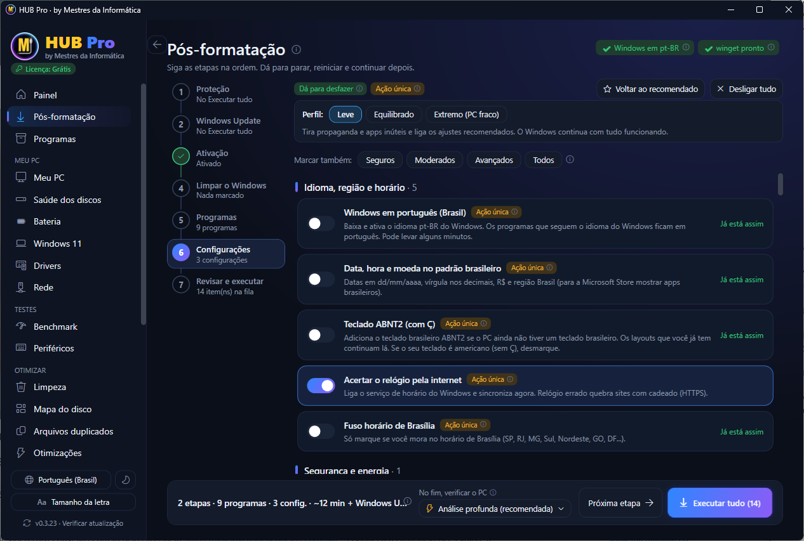

Tudo para depois de formatar, em 7 etapas e na ordem certa:
1. proteção do sistema;
2. Windows Update;
3. ativação;
4. limpar o Windows (apps de propaganda);
5. programas;
6. configurações;
7. revisão.

Os programas são instalados pelo instalador oficial da Microsoft (winget), direto do site de cada fabricante e **já em português**.

**Perfis Leve, Equilibrado e Extremo:** nas etapas 4 e 6, escolha um perfil e o HUB marca os apps a remover e as configurações.
- **Leve:** para qualquer PC.
- **Equilibrado:** também desliga Copilot, Widgets, Cortana, Teams e a gravação de jogos em segundo plano.
- **Extremo:** para PCs realmente fracos; também desliga serviços pesados (SysMain, indexação, hibernação) e liga o desempenho máximo.

Tudo pode ser desmarcado e desfeito depois.

**Como usar:** siga as etapas pela lista da esquerda, marque o que quer e clique em **Executar tudo**. Dá para parar, reiniciar o PC e continuar depois. Se você fez o [Backup para formatar](#backup-para-formatar), a primeira etapa acha o backup e devolve os drivers e as redes Wi-Fi. Não quer mexer no Windows Update? Desmarque a caixinha logo abaixo do botão da etapa 2.

---

### Programas

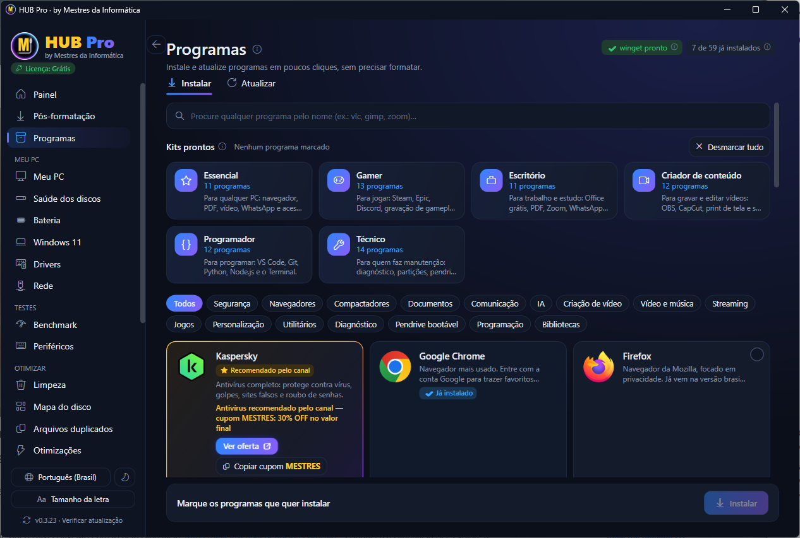

Instale programas com um clique e veja quais dos seus programas têm versão nova. Há kits prontos (Essencial, Gamer, Escritório, Criador de conteúdo, Programador e Técnico). A busca procura em todo o catálogo do winget e da Microsoft Store, com as versões em português primeiro.

**Como usar:** na aba **Instalar**, marque os programas e clique em instalar. Na aba **Atualizar**, marque o que quer atualizar e clique em **Atualizar selecionados**. O HUB instala um programa por vez e avisa quando algum programa aberto impede a atualização.

---

### Meu PC

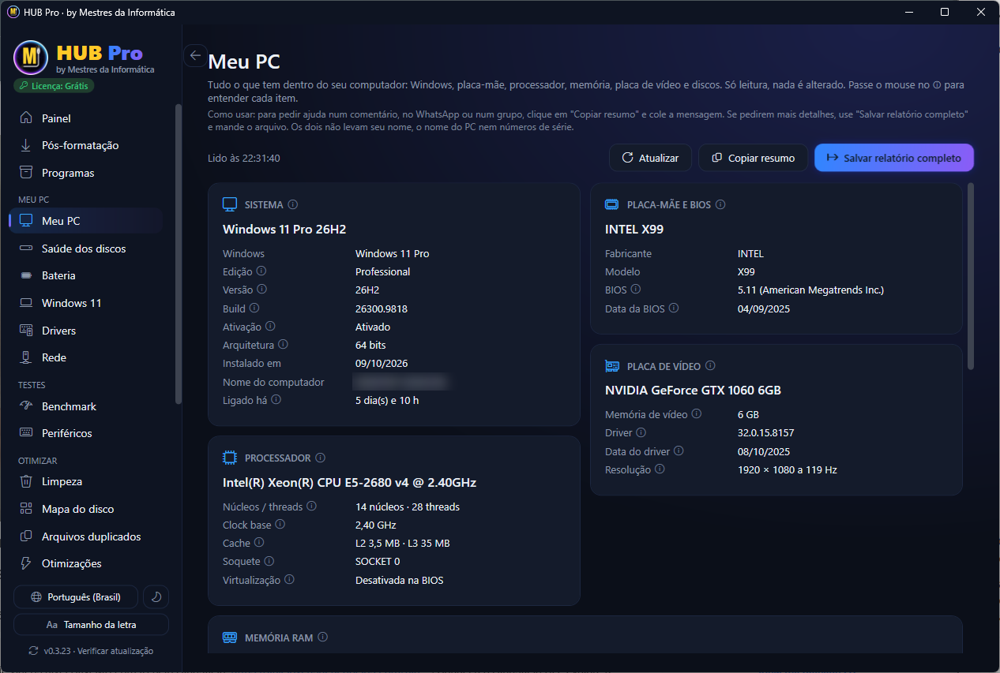

Tudo o que tem dentro do computador: Windows, placa-mãe, processador, memória, placa de vídeo e discos. Só leitura: nada é alterado. Passe o mouse no ⓘ de cada item para entender o que ele significa.

**Para pedir ajuda:** clique em **Copiar resumo** e cole no comentário do YouTube, no WhatsApp ou no grupo. O resumo traz a nota do Painel, o Benchmark e o último teste de internet, com a comparação com o anterior. Se pedirem mais detalhes, use **Salvar relatório completo**, que inclui telas azuis recentes, aparelhos sem driver, tempo para ligar, saúde dos discos, bateria e requisitos do Windows 11. **O relatório não leva o seu nome, o nome do PC nem números de série.**

---

### Saúde dos discos

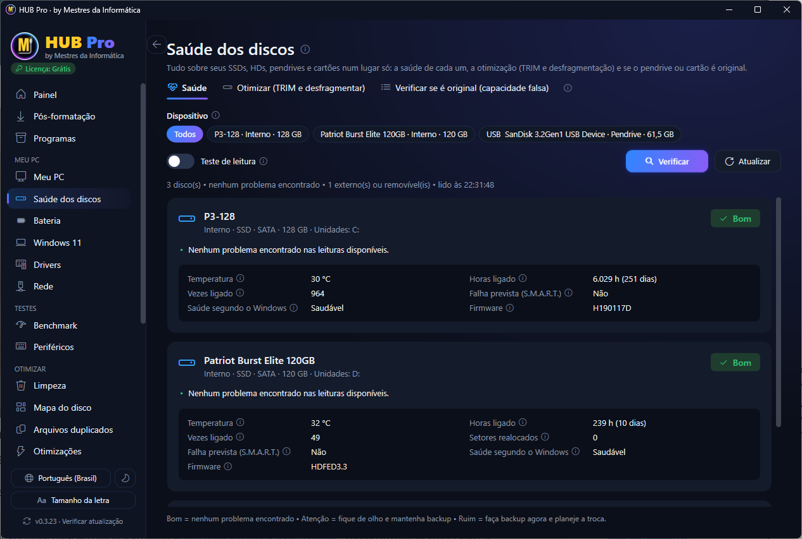

Mostra se cada HD, SSD, HD externo, pendrive e cartão está saudável: temperatura, desgaste e avisos de falha (S.M.A.R.T.).

**Como usar:** escolha o dispositivo e clique em **Verificar** para um exame completo, só de leitura. Ligue o **Teste de leitura** para ler o disco inteiro e achar setores com defeito.

**Aba Otimizar:** otimiza cada disco do jeito certo. O SSD recebe TRIM e o HD, desfragmentação. Ela também liga de volta a otimização semanal do Windows, se estiver desligada. O SSD só é desfragmentado quando precisa, e quem decide é você.

---

### Pendrive, cartão ou HD externo falsificado

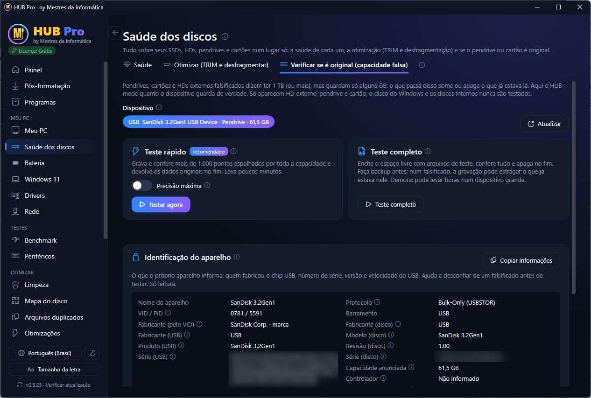

Na aba **Verificar se é original**, da tela Saúde dos discos. Muitos pendrives e cartões vendidos como "1 TB" ou "2 TB" guardam só alguns GB. O que passa disso some ou apaga o que já estava lá.

- **Teste rápido:** grava e confere mais de 1.000 pontos espalhados por toda a capacidade e devolve os dados originais no fim. Em poucos minutos mostra **quanto o aparelho guarda de verdade**.
- **Teste completo:** enche o espaço livre com arquivos de teste, confere tudo e apaga no fim. Faça backup antes: num aparelho falsificado, a gravação pode estragar o que já estava nele.
- **Identificação do aparelho:** mostra o que o próprio aparelho informa. Isso inclui o fabricante pelo código USB (VID/PID), o número de série, a versão e a velocidade do USB e o consumo. Aparecem **sinais de alerta**, como marca que não bate com o chip USB, número de série genérico, ou aparelho "USB 3" funcionando como USB 2.

O disco do Windows e os discos internos nunca são testados. A identificação dá pistas, mas a prova de verdade é o teste de gravação.

---

### Bateria

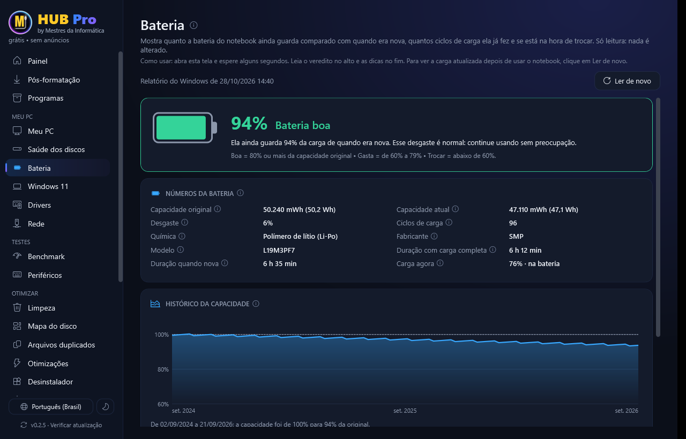

Para notebooks. Mostra quanto a bateria ainda guarda comparado com quando era nova, quantos ciclos de carga ela já fez e se está na hora de trocar, com o gráfico do histórico da capacidade. Os números vêm do relatório de bateria do próprio Windows.

---

### Windows 11

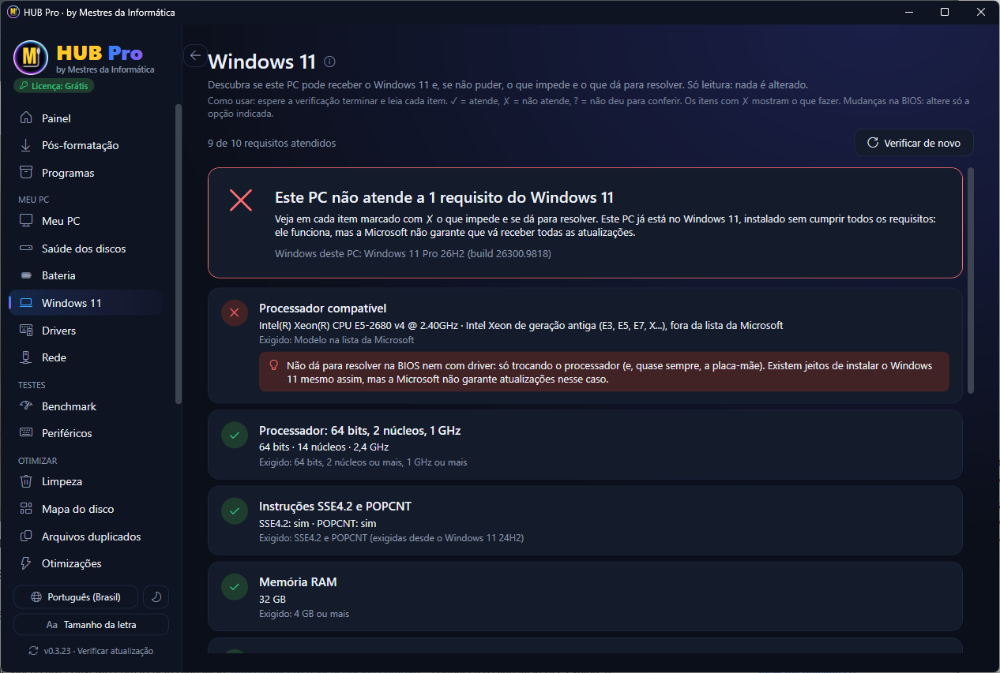

Confere, item por item, se o PC atende aos requisitos do Windows 11. A lista cobre:
- processador compatível e as instruções SSE4.2/POPCNT;
- memória e armazenamento;
- UEFI, Inicialização Segura e TPM 2.0;
- DirectX 12 e tela.

Cada item marcado com ✗ diz o que fazer, por exemplo ligar o TPM ou a Inicialização Segura na BIOS. Só leitura: nada é alterado.

---

### Drivers

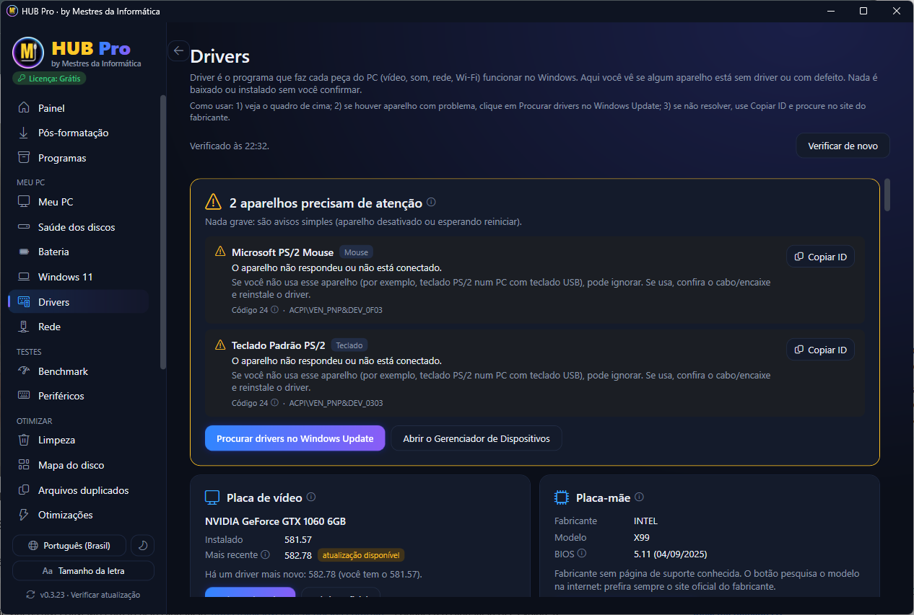

Mostra os aparelhos sem driver ou com defeito, com o ID para procurar o driver certo. Também tem:
- **Drivers pelo Windows Update**, dentro do HUB, um por um;
- o driver da placa de vídeo **NVIDIA, AMD ou Intel** pelo instalador oficial de cada fabricante, com a assinatura digital conferida;
- **backup e restauração dos drivers**.

Antes de instalar qualquer driver, o HUB cria um ponto de restauração.

---

### Rede

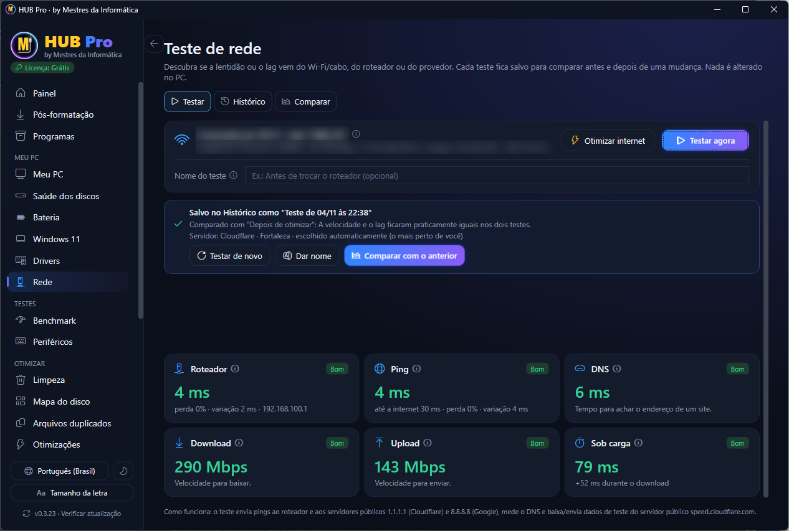

Teste de internet que mostra **onde está o problema**: no Wi-Fi/cabo, no roteador ou no provedor.
- **Velocidade:** mede download e upload do jeito do Speedtest, com várias conexões ao mesmo tempo e sem contar os primeiros segundos. O resultado mostra o servidor e a cidade usados, escolhidos sozinhos pelo mais perto de você.
- **Ping:** em destaque, o ping **até a sua operadora**, o mesmo tipo de número que o Speedtest mostra. Embaixo, o ping **até a internet**, que é o lag dos jogos e sites.
- **Mais medidas:** DNS, perda de pacotes, variação e resposta com a internet carregada.

Cada teste fica salvo no **Histórico** para comparar antes e depois de uma mudança. A comparação considera que a internet varia sozinha de um minuto para o outro. O botão **Otimizar internet** mede o melhor DNS para a sua internet e confere ajustes do Windows. Ele mostra tudo antes de mudar, testa antes e depois e tem **Reverter**.

---

### Benchmark

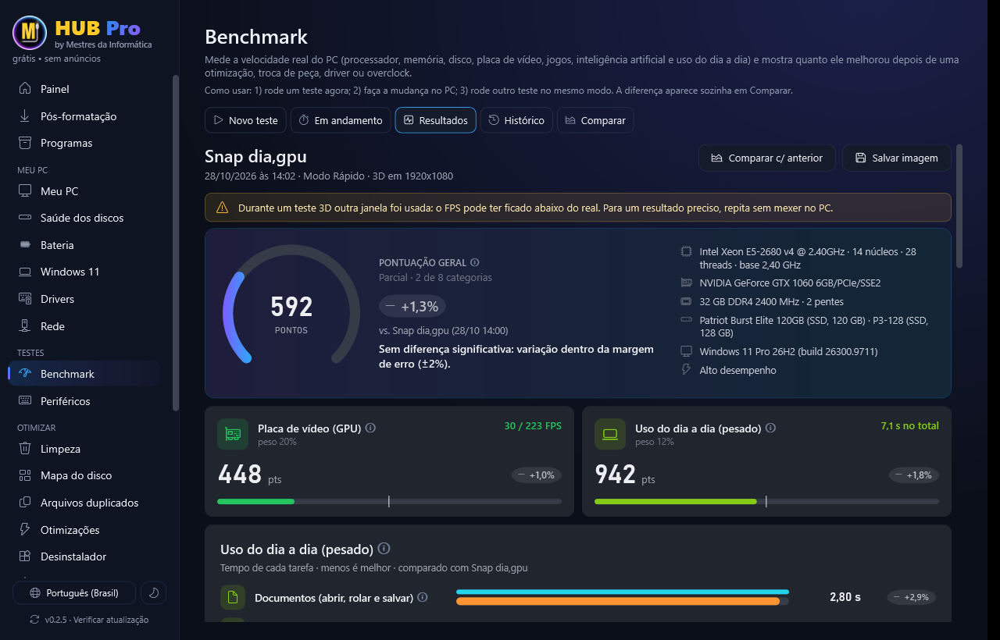

Mede a velocidade real do PC em 8 categorias:
- processador (1 núcleo e todos os núcleos);
- memória e disco;
- placa de vídeo e simulação de jogo;
- inteligência artificial;
- uso do dia a dia (pesado).

**1.000 pontos = um PC médio de hoje.** O dobro da pontuação é o dobro do desempenho.

**Como usar:**
1. Rode um teste.
2. Faça a mudança no PC (otimização, troca de peça, driver, overclock).
3. Rode outro teste no mesmo modo.

A diferença aparece sozinha em **Comparar**.

---

### Periféricos

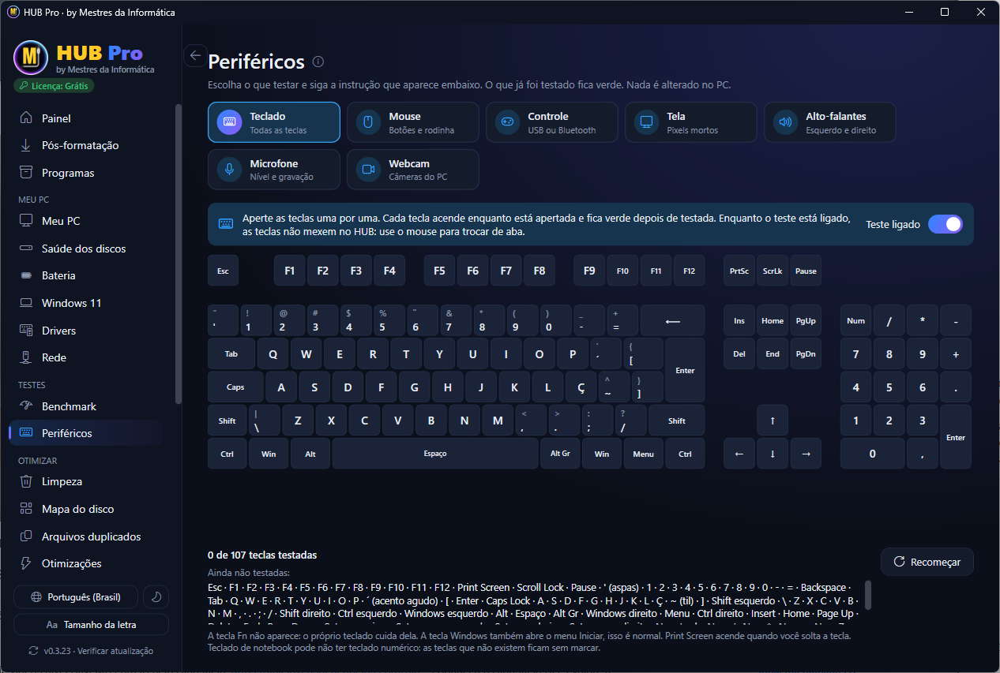

Testa se tudo está funcionando:
- **Teclado:** desenho ABNT2 que acende cada tecla.
- **Mouse:** todos os botões e a rolagem.
- **Controle de videogame:** Xbox, PlayStation, Switch Pro e genéricos, por cabo ou Bluetooth. Testa botões, analógicos (com o drift e o formato do círculo), gatilhos e vibração.
- **Tela:** cores em tela cheia para achar pixels mortos.
- **Alto-falantes:** som no lado esquerdo e no lado direito.
- **Microfone:** nível do som ao vivo e gravação de teste.
- **Webcam.**

Os desenhos se ajustam ao tamanho da janela. Nada é alterado no PC.

---

### Limpeza

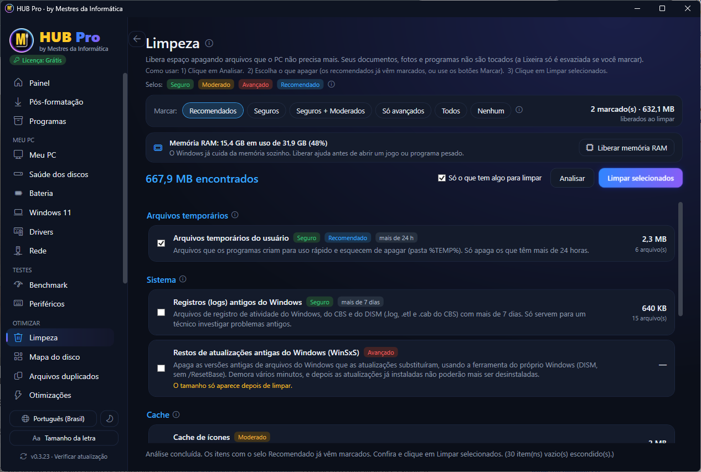

Libera espaço apagando o que o PC não precisa mais: arquivos temporários, caches e restos de atualizações. Seus documentos, fotos e senhas **nunca** são tocados, e a limpeza nunca entra em atalhos de pasta.

**Como usar:** clique em **Analisar**, confira os itens (os com o selo **Recomendado** já vêm marcados) e clique em **Limpar selecionados**. Os itens demorados, como os restos de atualizações, mostram o tempo e a porcentagem, e o botão **Parar** interrompe com segurança.

**Liberar memória RAM:** devolve ao Windows a memória parada dos programas abertos, sem fechar nenhum. Bom antes de abrir um jogo ou um programa pesado.

---

### Mapa do disco

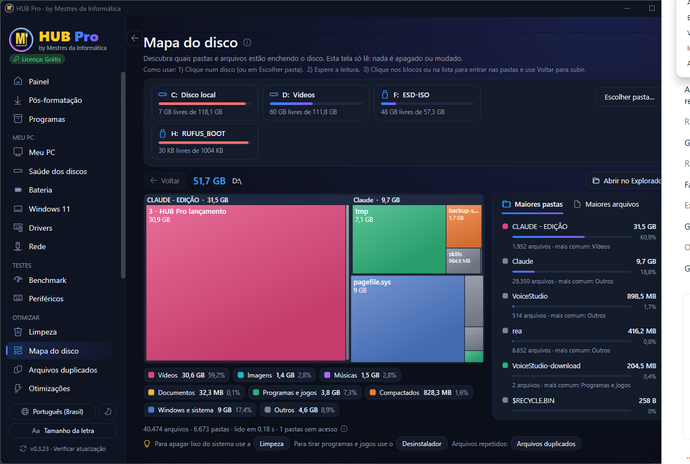

Mostra num mapa de blocos quais pastas e arquivos estão enchendo o disco: quanto maior o bloco, mais espaço ele ocupa. Tem também a lista das maiores pastas e dos maiores arquivos, e o resumo por tipo (vídeos, imagens, programas e jogos...). **Só olha: nada é apagado.**

**Como usar:** clique num disco (ou em **Escolher pasta**), espere a leitura e clique nos blocos para entrar nas pastas.

---

### Arquivos duplicados

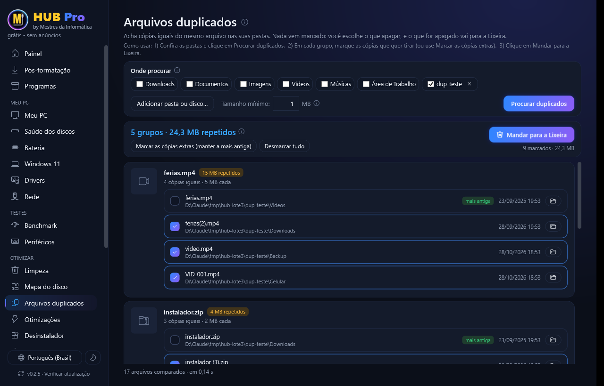

Acha cópias iguais do mesmo arquivo nas suas pastas, mesmo com nomes diferentes. A comparação é feita pelo conteúdo do arquivo. **Nada vem marcado:** você escolhe o que apagar, e o que for apagado vai para a **Lixeira**. O HUB nunca deixa apagar todas as cópias de um arquivo, e pastas do Windows e de programas ficam de fora.

**Como usar:** marque as pastas, clique em **Procurar duplicados**, marque as cópias que quer tirar (ou use **Marcar as cópias extras**) e clique em **Mandar para a Lixeira**.

---

### Otimizações

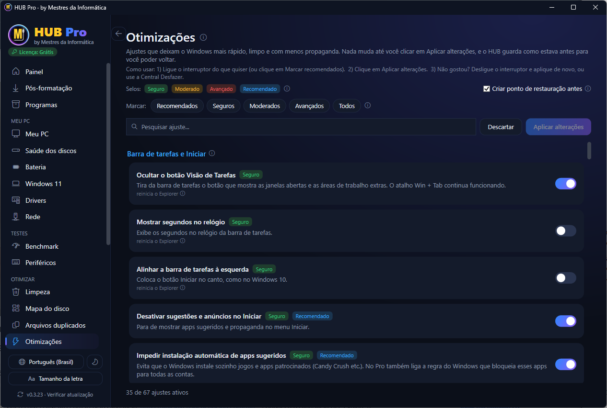

**69 ajustes** que deixam o Windows mais rápido, limpo e com menos propaganda e rastreamento, separados por assunto:
- Barra de tarefas e Iniciar, com a **Barra de tarefas menor** e o **Finalizar tarefa** no botão direito.
- Explorador de Arquivos.
- **Inteligência artificial do Windows:** Copilot, Recall e Clique para Fazer.
- **Propaganda e sugestões.**
- Privacidade e **permissões dos apps**.
- Desempenho e jogos, com os **Efeitos visuais leves**.
- Serviços, Windows Update, rede e segurança.
- Aparência, teclado e mouse.

Cada ajuste tem um selo (Seguro, Moderado, Avançado, Recomendado) e uma explicação. Os botões **Marcar** ligam de uma vez os Recomendados, os Seguros, os Moderados, os Avançados ou Todos. Nada muda até você clicar em **Aplicar alterações**, e o HUB guarda como estava antes: tudo pode ser desfeito na [Central Desfazer](#central-desfazer).

---

### Desinstalador

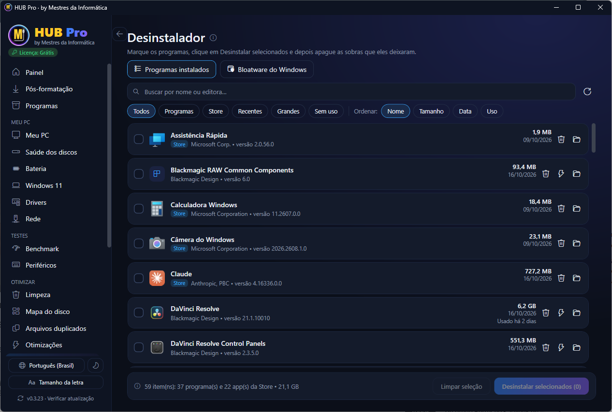

Desinstala vários programas de uma vez e apaga as sobras que ficam para trás. O filtro **Sem uso** mostra os programas que você não abre há meses, pelo histórico que o próprio Windows guarda.

Na aba **Bloatware do Windows** dá para remover os apps de propaganda que já vêm no Windows, também para os novos usuários, para eles não voltarem nas atualizações. Dá também para **reinstalar** qualquer um deles depois, se quiser.

---

### Inicialização

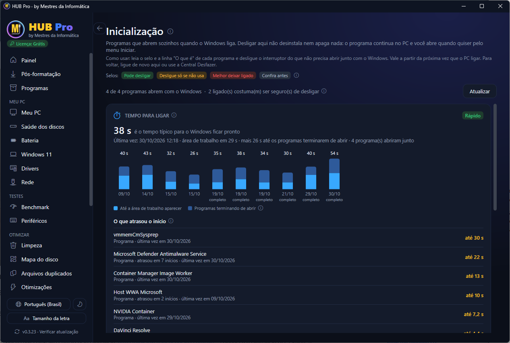

Mostra **quanto tempo o Windows leva para ligar**, com o gráfico das últimas vezes e o que atrasou o início. Também lista os programas que abrem junto com o Windows, cada um com ícone, explicação e um selo dizendo se é seguro desligar. Desligar aqui não desinstala nada.

---

### Reparar o Windows

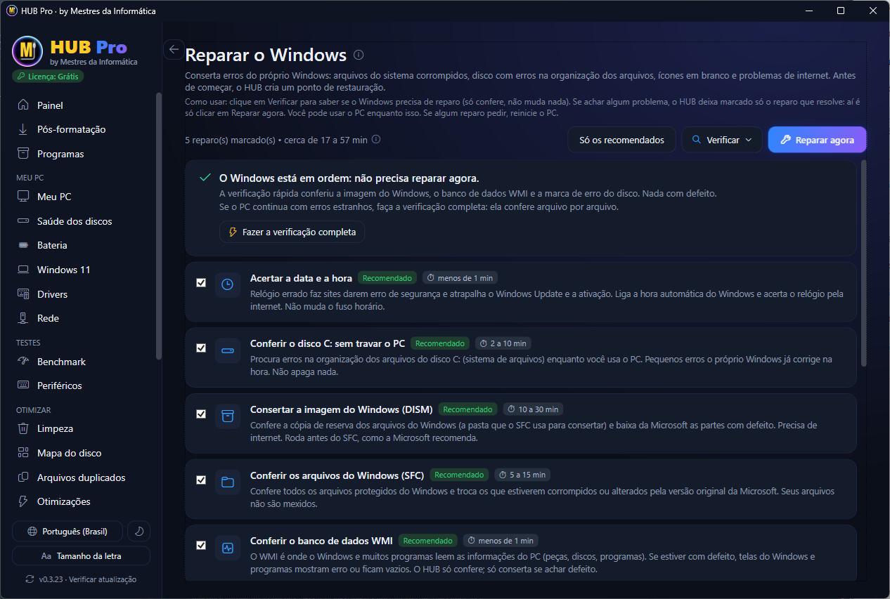

Conserta erros do próprio Windows com as ferramentas oficiais da Microsoft, na ordem que ela recomenda:
- **Data e hora:** liga a hora automática e acerta o relógio pela internet (relógio errado faz sites darem erro de segurança).
- **Disco:** conferência do disco (chkdsk) e correção no próximo reinício.
- **Arquivos do Windows:** DISM e SFC.
- **Programas e telas que mostram erro:** banco de dados WMI.
- **Ícones em branco:** cache de ícones.
- **Internet:** configuração de internet.

**Verificar antes de reparar:** o botão **Verificar** (rápido, menos de 1 minuto, ou completo, 15 a 40 minutos) confere se o Windows tem defeito sem mudar nada. Ele deixa marcado só o reparo que resolve, ou avisa que não precisa reparar.

**Como usar:** clique em **Verificar**. Se aparecer algum problema, clique em **Reparar agora**. Antes de começar, o HUB cria um ponto de restauração, e no fim aparece um resumo simples do que foi achado e consertado. Dá para usar o PC enquanto isso. Os reparos têm limite de tempo, e o **Parar agora** interrompe com segurança.

---

### Pontos de restauração

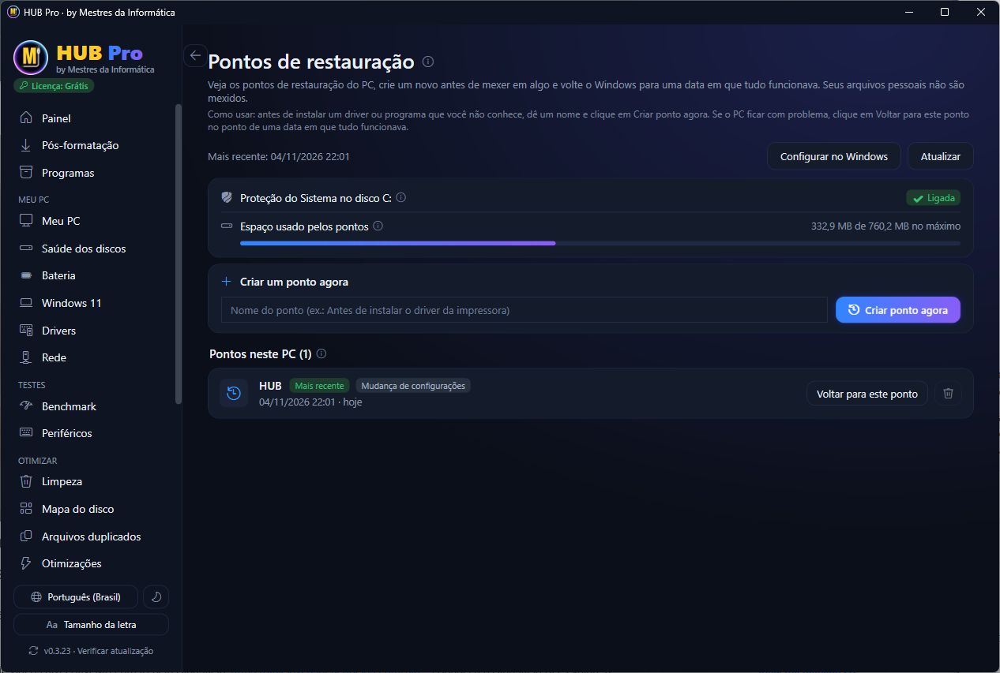

Veja os pontos de restauração do PC, quanto espaço eles usam e se a proteção está ligada. Antes de instalar algo que você não conhece, crie um ponto com o nome que quiser. Se o PC ficar com problema, clique em **Voltar para este ponto**. O mais recente nunca pode ser apagado pelo HUB, para você sempre ter uma volta segura.

---

### Central Desfazer

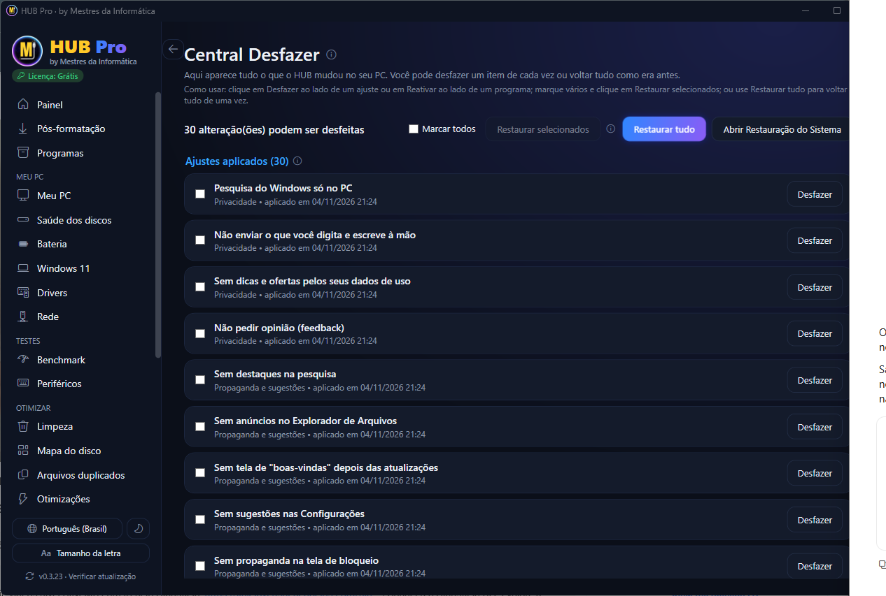

Lista tudo o que o HUB mudou no PC (ajustes, programas da inicialização, desinstalações) e volta cada coisa como era. Marque um ou vários itens e use **Restaurar selecionados**, ou **Restaurar tudo**. Também abre a Restauração do Sistema do Windows.

---

### Backup para formatar

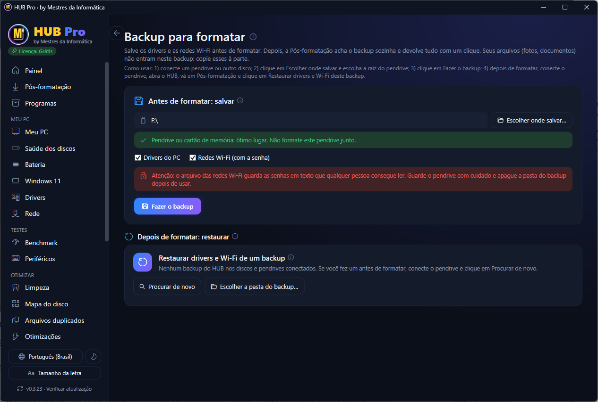

Antes de formatar, salve **os drivers e as redes Wi-Fi (com as senhas)** num pendrive. Depois de formatar, conecte o pendrive, abra o HUB e vá em **Pós-formatação**: o HUB acha o backup e devolve tudo com um clique em **Restaurar drivers e Wi-Fi deste backup**.

**Atenção:** o arquivo das redes Wi-Fi guarda as senhas em texto legível. Guarde o pendrive com cuidado e apague a pasta do backup depois de usar. Seus arquivos pessoais (fotos, documentos) não entram neste backup: copie esses à parte.

---

### Sobre, licença e avisos de vídeo novo

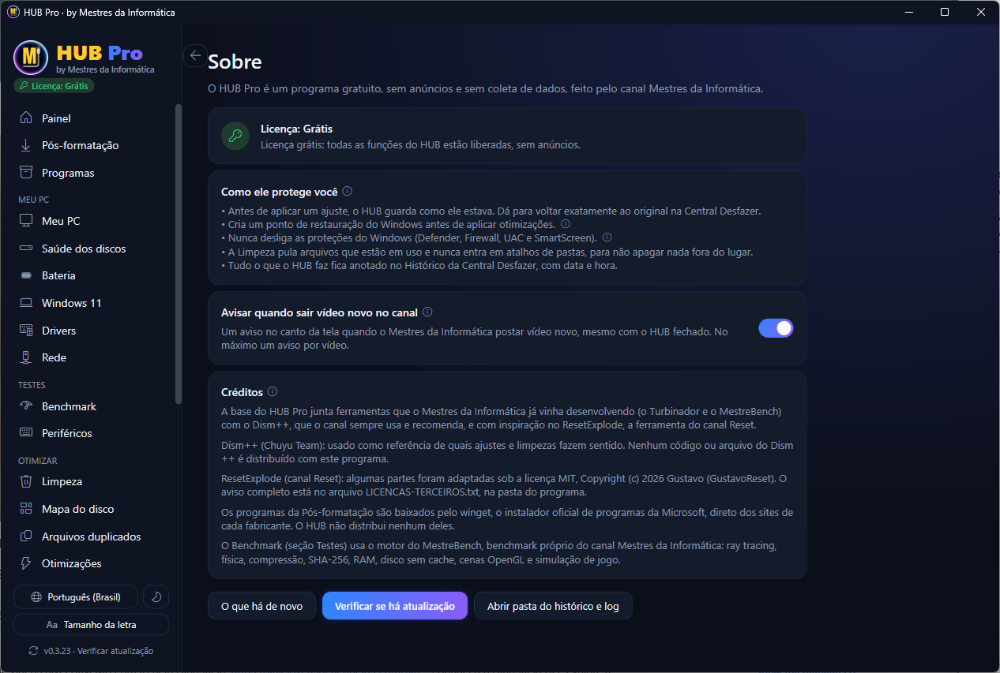

Versão, licença, créditos e onde ficam os backups e o log.

- **Licença:** o menu e a tela Sobre mostram **"Licença: Grátis"**. Todas as funções estão liberadas, sem anúncios.
- **Avisos de vídeo novo:** a chave **Avisar quando sair vídeo novo no canal** faz o HUB mostrar no Painel e no canto da tela quando o Mestres da Informática posta um vídeo novo, mesmo com o HUB fechado. É no máximo um aviso por vídeo, só entre 8h e 22h, e Shorts não contam. O HUB lê a lista pública de vídeos do canal no YouTube, sem conta e sem enviar nenhum dado do seu PC.

---

## Letra maior, leitor de tela e atalhos

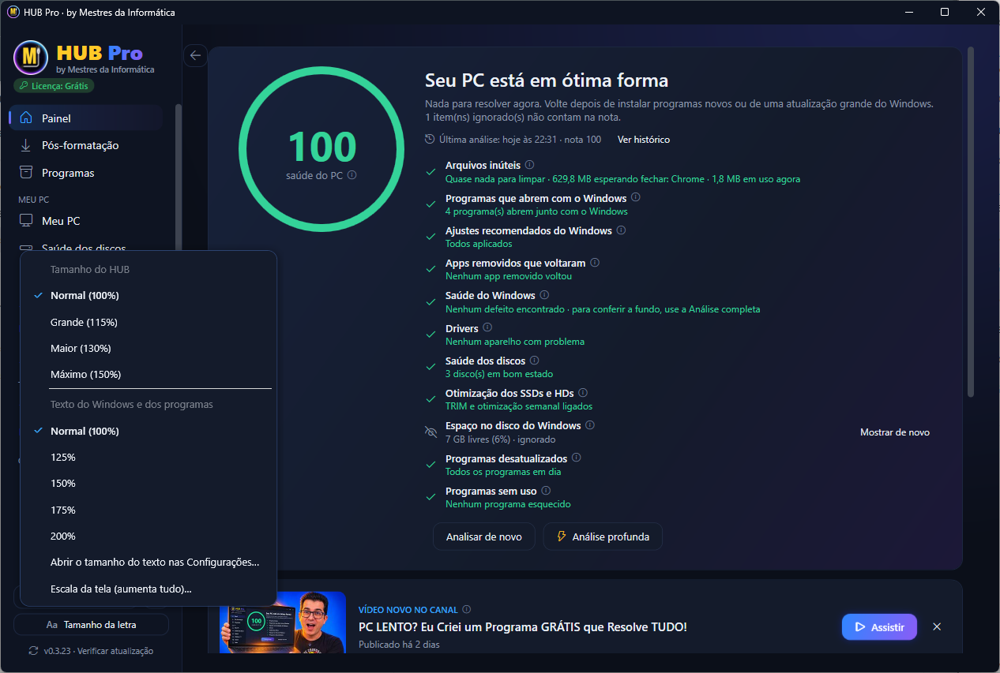

- **Tamanho da letra** (no rodapé do menu):
  - aumenta o HUB inteiro para 115%, 130% ou 150%;
  - aumenta também o **texto do Windows e dos programas** (125% a 200%);
  - tem atalhos para o tamanho do texto e a escala da tela nas Configurações do Windows.

  Para voltar, escolha **Normal (100%)**.
- **Leitor de tela:** com o NVDA ou o Narrador, cada botão é lido pelo nome, com a dica junto.
- **Voltar:** a seta no alto da tela volta para a tela anterior. Também funciona com o botão lateral do mouse e com **Alt + seta para a esquerda**.

---

## Segurança em primeiro lugar

- Cria um **ponto de restauração** antes de mudar qualquer coisa.
- Todo ajuste guarda o valor original e pode ser desfeito na **Central Desfazer**.
- **Nunca** desliga o Windows Defender, o Firewall, o UAC, o SmartScreen, o Windows Update ou a Microsoft Store.
- As análises e verificações **só leem**: nada muda no PC até você mandar corrigir.
- Arquivos do usuário só são apagados pela **Lixeira**, e só o que você marcou.
- Os reparos e o Windows Update têm limite de tempo e podem ser parados com segurança.
- Backups e arquivos usados como administrador ficam numa **pasta protegida**, onde outros programas não mexem.
- As ferramentas do Windows são chamadas pelo caminho completo, e as atualizações do próprio HUB são conferidas (SHA-256) antes de instalar.

## Privacidade

- O HUB Pro **não coleta dados** e não tem anúncios.
- O relatório do Meu PC não leva o seu nome, o nome do PC, números de série, IP, nome do Wi-Fi ou senhas.
- A internet só é usada quando a função precisa:
  - procurar atualizações do HUB (GitHub);
  - procurar, instalar e atualizar programas (winget e Microsoft Store; na busca, o ícone vem da Store ou do site oficial de cada programa);
  - drivers;
  - teste de internet (Cloudflare);
  - conferir a hora certa (servidores públicos de hora, como o time.windows.com);
  - a página de Sugestões;
  - o aviso de vídeo novo (lista pública do YouTube).

## Perguntas comuns

**O HUB Pro é gratuito mesmo?** Sim. A licença é grátis, todas as funções estão liberadas e não há anúncios.

**Precisa de internet?** Só para as funções que baixam algo (programas, drivers, atualizações), para o teste de rede e para acertar a hora. Limpeza, análise, reparos e a maior parte das telas funcionam sem internet.

**Posso desfazer o que o HUB fez?** Sim. Ajustes e programas da inicialização voltam pela **Central Desfazer**, e o ponto de restauração volta o Windows inteiro para antes.

**O teste de internet do HUB dá diferente do Speedtest. Qual está certo?** Os dois. A velocidade agora é medida do mesmo jeito, então os números ficam parecidos. O ping em destaque é até a sua operadora, como no Speedtest. Diferenças pequenas acontecem porque a internet varia de um minuto para o outro e porque os servidores ficam em lugares diferentes.

**Trocar o DNS diminui o ping?** Não. O DNS só acha o endereço dos sites. O ping é o tempo da viagem até o servidor, e o DNS não muda isso.

**Como desligo os avisos de vídeo novo?** Na tela **Sobre**, desligue a chave **Avisar quando sair vídeo novo no canal**. Desinstalar o HUB também apaga a tarefa agendada desses avisos.

## Sugestões e problemas

Use a página **Sugestões** dentro do próprio HUB Pro: a mensagem chega direto para o canal.

## Mestres da Informática

[YouTube](https://www.youtube.com/c/mestresdainformatica) ·
[Seja membro](https://www.youtube.com/channel/UCNblNh-u0nu5mtXT84Wgdiw/join) ·
[Instagram](https://www.instagram.com/mestresdainformatica/) ·
[Threads](https://www.threads.com/@mestresdainformatica) ·
[Facebook](https://www.facebook.com/mestresdainformaticaoficial) ·
[Site](https://mestresdainformatica.com.br/)

---

© 2026 Mestres da Informática. A base do HUB Pro junta ferramentas próprias do canal (Turbinador e MestreBench), o Dism++ como referência e inspiração no ResetExplode, do canal Reset — veja [LICENCAS-TERCEIROS.txt](LICENCAS-TERCEIROS.txt).
